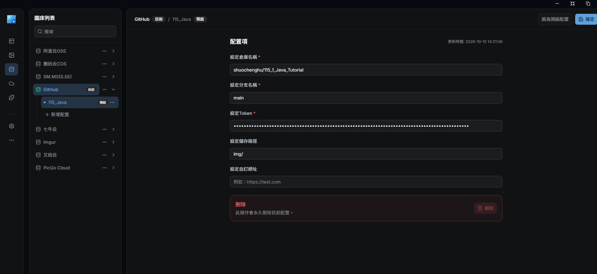

# 第二週 AI 使用紀錄

每欄簡短填寫即可，不必貼上完整對話。未試用 AI 時，第一欄填「未使用」及原因，其餘免填。

| 欄位 | 學生填寫 |
|---|---|
| 使用工具 | Gemini (AI 助手) |
| 使用目的與提問摘要 | 請 AI 協助完成 RoverDashboard.java 與 MissionLog.java 的 TODO 1~5 實作、解決 Terminal 執行路徑錯誤，並確認 Markdown 圖片相對路徑與 GitHub 同步流程。 |
| AI 建議與本人處理 | AI 提供整數除法/取餘數計算、ArrayList 紀錄與 Collections 工具方法實作，並指出未存檔與路徑錯誤原因。我採納建議修改程式碼，於 VS Code 存檔後重新執行驗證，並依指導設定圖片路徑。 |
| 實際驗證結果 | 執行成功。RoverDashboard 與 MissionLog 均正確輸出預期數據（如 counts=[0, 2, 1, 0]、lowest energy=6），結果完全一致，且成功上傳至 GitHub。 |

只記錄實際發生的使用與測試；AI 說「正確」不能替代實際執行。不要上傳個資、密碼或未授權資料。
## 填寫範例：電量百分比算成 0.0

以下為模擬填寫內容，不代表已實際使用 AI 或完成測試。請保留上方空白表格，依自己的使用與執行結果填寫，不要直接照抄範例。

| 欄位 | 範例 |
|---|---|
| 使用工具 | ChatGPT（模擬情境） |
| 使用目的與提問摘要 | 想找出百分比計算錯誤。我問：「energy 是 int，值為 7，為什麼 `energy / 20 * 100.0` 得到 0.0？請解釋計算順序並提供最小修改。」 |
| AI 建議與本人處理 | AI 建議將 20 改為 20.0。我採納，因為原本 `7 / 20` 先做整數除法得到 0；最後改成 `energy / 20.0 * 100`，讓除法保留小數。 |
| 實際驗證結果 | 輸入 7，預期 35.0，修改前為 0.0、修改後為 35.0；另測 0 和 20，修改後為 0.0 和 100.0，符合預期。其餘結果可引用實作講義 D 的測試表。 |

若沒有使用 AI，可填：「未使用；我依課堂範例自行找出整數除法問題。」其餘欄位免填，講義要求的測試仍須完成。

### 範例附圖

