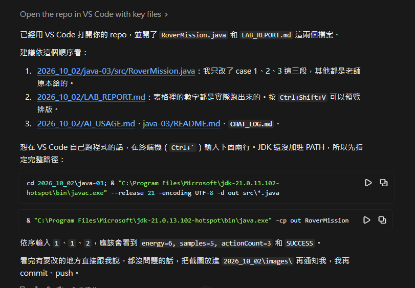
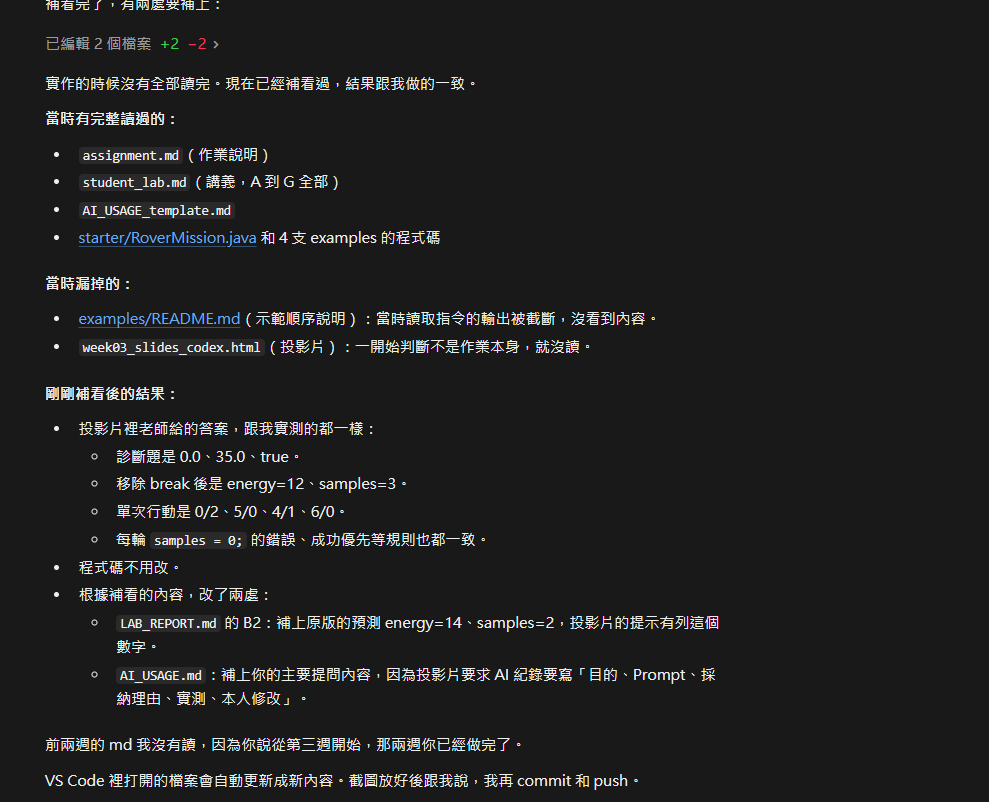

# 第三週與 AI 的討論過程

使用工具：Claude Code。以下為對話截圖（放在 `images/` 資料夾）。

## 討論流程摘要

1. 我說明作業規則：每週 starter 是要做的作業、要連 GitHub、先複製再修改、對話截圖要放進 md 一起上傳，從第三週開始。
2. AI 讀取 repo 與第三週的 assignment.md、student_lab.md、starter，發現電腦沒有安裝 Java。
3. AI 詢問 JDK 安裝方式與日期目錄；我選擇讓 AI 用 winget 安裝 JDK 21，並告知每週五上課、今天 11/20 是第十週，推算第三週是 2026_10_02。
4. AI 建立 `2026_10_02/java-03/src`，複製 starter 和 examples 後才完成 D1–D3。
5. AI 實際編譯執行四條必做路線、三筆固定狀態、`energy > 6` 反例，結果都和預期一致，再填寫 LAB_REPORT、AI_USAGE、README。
6. 我在 VS Code 打開專案檢查，並追問 AI 是否讀完所有 md。AI 承認漏讀 examples/README.md 和投影片，補讀後確認答案一致，並補上 LAB_REPORT B2 的原版預測與 AI_USAGE 的 Prompt。

## 截圖

### 1. 用 VS Code 打開專案，先檢查 AI 做的內容

### 2. 追問 AI 是否讀完所有 md 檔

