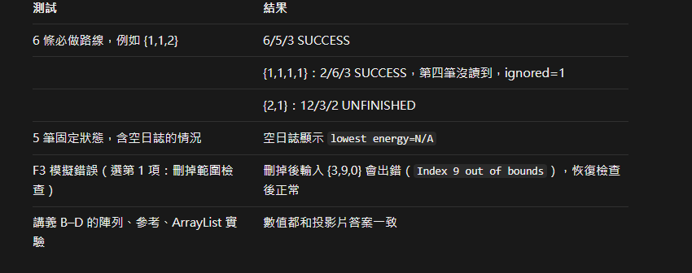
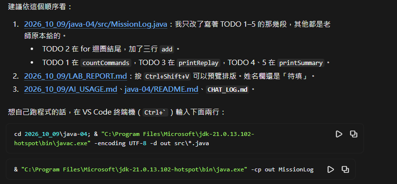

# 第四週與 AI 的討論過程

使用工具：Claude Code。

## 討論流程摘要

1. 第三週完成後，我確認自己的 GitHub 網址，發現 repo 是私人的，老師會看到 404；AI 教我在 GitHub 網頁 Settings → Danger Zone 改成公開，改完後 AI 從外部確認網址可以開啟。
2. 我說「開始做第四週的作業」。AI 依每週五上課推算第四週是 2026_10_09。
3. 因為第三週被我問到有沒有讀完所有 md，這次 AI 先讀完 week04 的講義、AI 範本、examples/README、投影片和全部 Java 檔，並告訴我 week04 沒有 assignment.md。
4. AI 先把 starter 和五個核心 examples 複製到 `2026_10_09/java-04/src`，再完成 MissionLog 的 TODO 1–5。
5. AI 實際編譯執行：六條必做路線、五筆固定狀態、講義 B–D 的陣列與 ArrayList 實驗，以及 F3 的模擬錯誤（刪掉範圍檢查 → counts[9] 越界），結果都與投影片答案一致，再填寫 LAB_REPORT、AI_USAGE、README。
6. 我請 AI 用 VS Code 打開專案，自己檢查程式和報告後，才讓 AI 推送。

## 截圖

### 1. AI 回報第四週的測試結果

### 2. 在 VS Code 打開專案檢查

