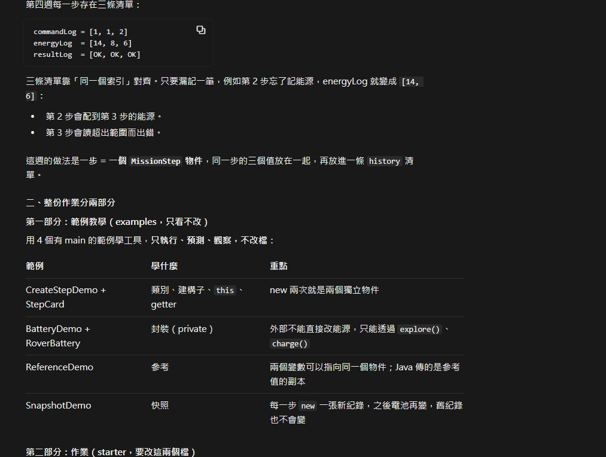
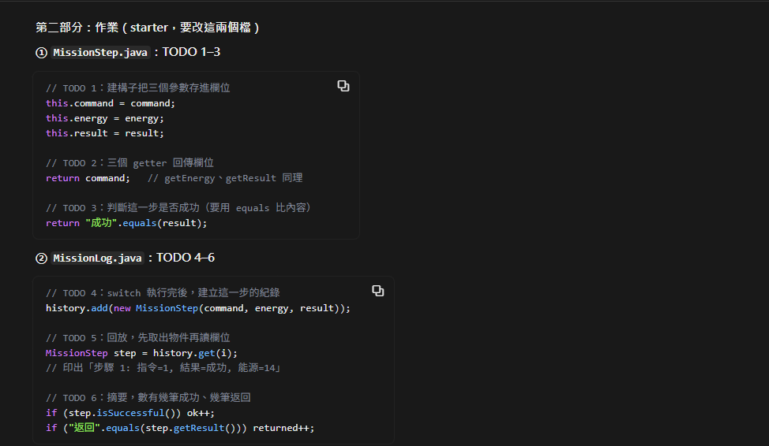
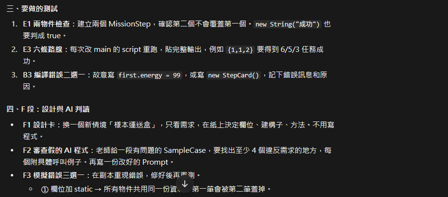

# 第五週與 AI 的討論過程

使用工具：Claude Code。

## 討論流程摘要

1. 我說「開始做第五週的作業，老師有時候的作業規範要改什麼檔案你要看清楚」。AI 依每週五上課推算第五週是 2026_10_16。
2. AI 讀教材時發現：學期 repo 裡的課程資料是舊版，我今天下載的新版教材有差異——結果代碼和報表改成繁體中文，投影片換成 claude 版，還多了 UML 圖。AI 也發現第四週新版同樣改成中文輸出（邏輯不變）。
3. AI 讀完新版投影片，整理出本週只需要改 starter 的 MissionStep（TODO 1–3）與 MissionLog（TODO 4–6），examples 六支只執行、不修改；錯誤實驗只能在 repo 外的副本做。
4. AI 先把新版 examples 六檔與 starter 兩檔複製到 `2026_10_16/java-05/src`，再完成 TODO 1–6。
5. AI 實際編譯執行：四個範例、E1 兩物件檢查、六條路線、五筆固定狀態、B3 兩種編譯錯誤、C1 刪 private 實驗，以及 F3 三種模擬錯誤，結果都和投影片一致，再填寫 LAB_REPORT、AI_USAGE、README。
6. 我在 VS Code 打開專案檢查，並請 AI 詳細解說第五週作業的內容與做法（見下方截圖）。

## 截圖

我請 AI 詳細解說第五週的作業要怎麼做，以下是 AI 的解說：

### 1. 為什麼要改、範例教學部分

### 2. 作業要改的兩個檔案

### 3. 要做的測試與 F 段

