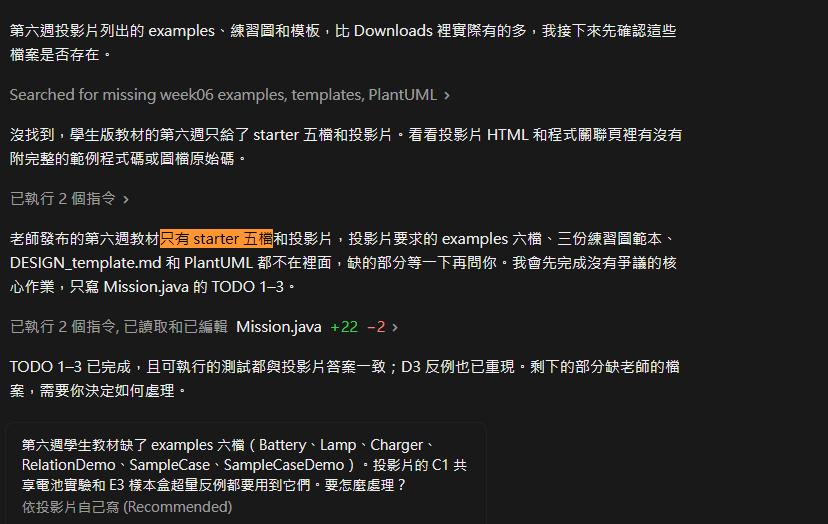
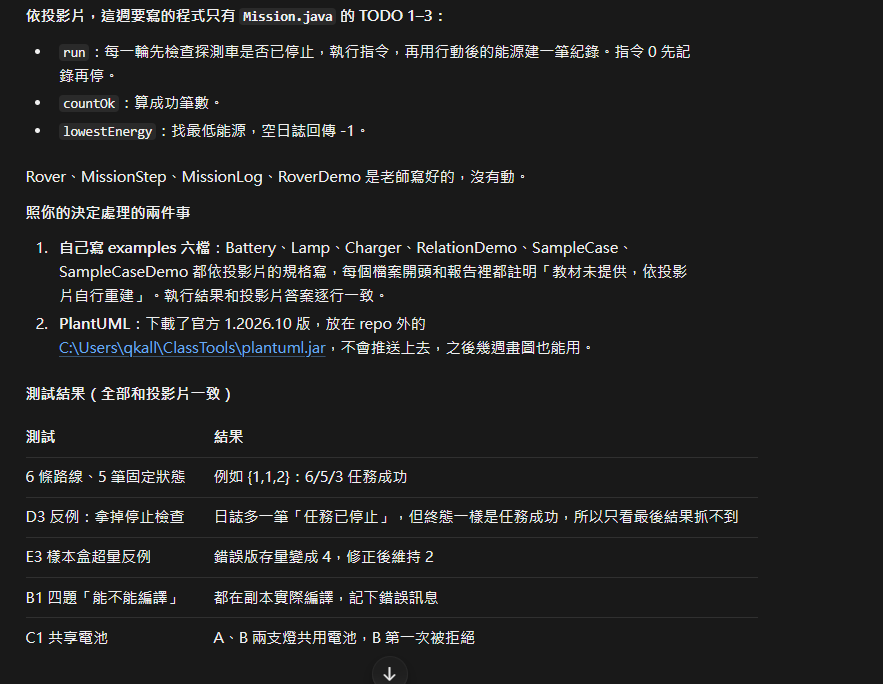
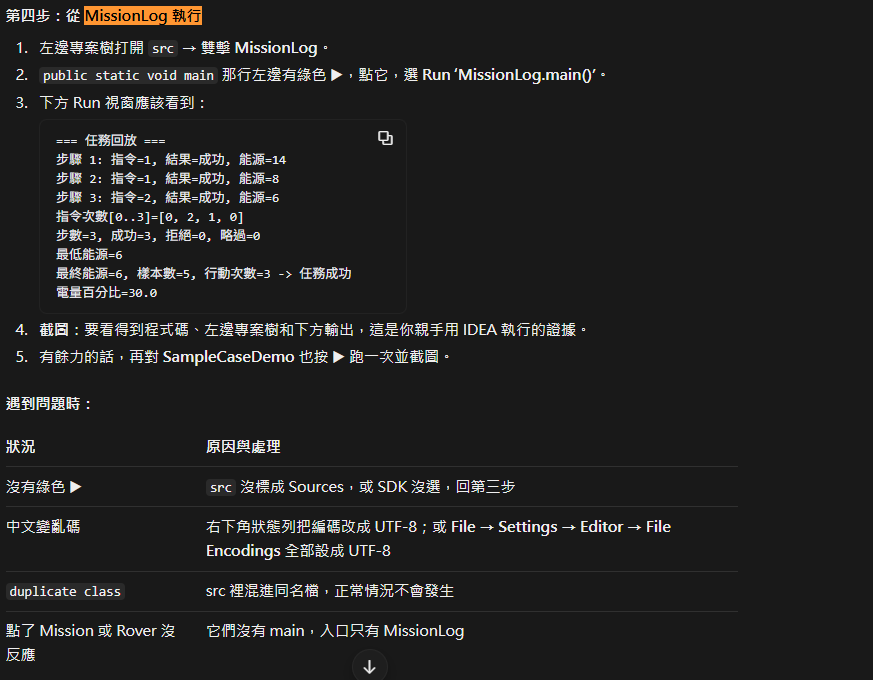

# 第六週與 AI 的討論過程

使用工具：Claude Code。

## 討論流程摘要

1. 我傳了老師上課用 IntelliJ IDEA 的照片，問老師用的是什麼方法。AI 說明那是 IntelliJ IDEA，教的是第七、八週的繼承與重構（HeavyRover、protected 的 spendEnergy 等），並確認第六週教材明確寫「不用繼承」。
2. 我說「開始做第六週的作業」。AI 依每週五上課推算第六週是 2026_10_23，並讀完第六週的投影片、starter 五檔與 AI 範本。
3. AI 發現老師發布的學生版教材缺了 examples 六檔、三份練習圖範本、DESIGN_template.md，也沒有 PlantUML。AI 先完成不受影響的 Mission TODO 1–3 並跑完六條路線，再問我怎麼處理缺件；我選擇「依投影片自己寫」examples，並同意從 PlantUML 官方 GitHub 下載 jar。
4. AI 依投影片規格重建 examples 六檔，執行結果和投影片答案逐行一致；畫三張類別圖並用 PNG 預覽檢查，發現全形減號顯示成方框後修正重畫。
5. AI 實際執行 B1 四題編譯判斷、C1 共享電池、D1 RoverDemo、D3 六條路線與停止檢查反例、E3 樣本盒超量反例，再寫 DESIGN.md、LAB_REPORT、AI_USAGE、README。
6. 我在 11/25 自己用 GitHub Desktop commit（「1120」），11/27 與第七週一起推送；AI 另外 clone 新副本驗證。
7. 我安裝 IntelliJ IDEA（第一次下載到 ARM64 版無法安裝，AI 確認電腦是 x64 後重新下載），AI 一步一步說明，我自己開啟 java-06 並從 MissionLog 執行成功，截圖補進 LAB_REPORT D1。

## 截圖

以下為當時對話的原始截圖（不是事後重新輸出的內容）。

### 1. 發現教材缺件，先做不受影響的部分，再問我怎麼處理

### 2. 第六週完成回報

### 3. 用 IntelliJ IDEA 從 MissionLog 執行的操作說明

