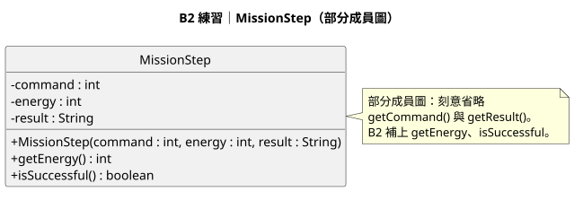
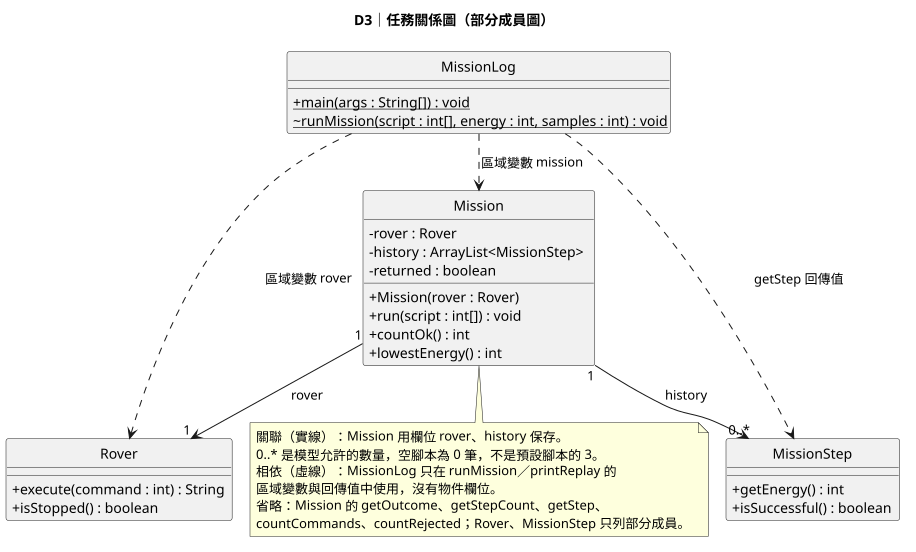
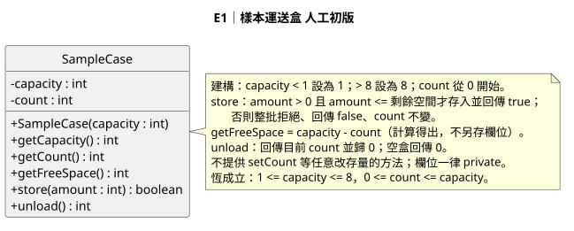

# 第六週設計文件：用類別圖分配責任

> 老師發布的第六週學生教材沒有附 `DESIGN_template.md`，本文件依投影片 G 段規定的內容（圖、責任表、初版與採納理由）自行整理。
> 圖用 PlantUML 1.2026.10 由 `.puml` 產生 `.svg`：`java -jar C:\Users\qkall\ClassTools\plantuml.jar -charset UTF-8 -tsvg diagrams\*.puml`，每次改 `.puml` 都重新產生。

## 1. 四個類別的責任表（D1）

| 類別 | 保存什麼 | 負責什麼 | 不負責什麼 |
|---|---|---|---|
| MissionStep | command、energy、result | 一步行動後的只讀資料、isSuccessful | 推進任務、輸出 |
| Rover | 目前的 energy、samples、actionCount | 行動規則（探索、掃描、充電）；外部只能走 execute；成功或耗盡後回「任務已停止」、不再改狀態 | 讀腳本、保存歷史、記住「已返回」、輸出報表 |
| Mission | rover、history（`ArrayList<MissionStep>`）、returned | 依序執行腳本、每步行動後建立快照存進 history、指令 0 記錄後停止、停止後不再讀也不記；提供結果、指令次數、成功、拒絕、最低能源等查詢 | 行動的扣能源與樣本規則、輸出格式 |
| MissionLog | 沒有物件欄位 | 程式入口、預設腳本 {1,1,2}、建立 Rover 與 Mission、把查詢結果格式化成報表 | 行動規則、任務流程、保存狀態 |

判斷依據：誰知道目前能源與樣本（Rover），誰就守住「成功／耗盡後不再行動」；誰知道腳本、歷史與「已返回」（Mission），誰就守住「不再讀、不再記」。如果輸出改成別的介面（例如 WinForms 視窗），只需要換掉 MissionLog，Rover、Mission、MissionStep 都不用動。

## 2. B2 練習圖：MissionStep（部分成員）

依 Java 補上 `+ getEnergy() : int` 與 `+ isSuccessful() : boolean`：兩個都是 public（+）、不需要參數、名稱在前、回傳型態在最後。note 標明這是部分成員圖，刻意省略 getCommand、getResult。

## 3. D3 任務關係圖

| 從 → 到 | 線 | 多重性 | 程式證據 |
|---|---|---|---|
| Mission → Rover | 關聯（實線） | 1 | 欄位 `private Rover rover;`，建構子傳入一台 |
| Mission → MissionStep | 關聯（實線） | 0..* | 欄位 `private ArrayList<MissionStep> history;`；空腳本或初始已停止時為 0 筆，不是寫死預設腳本的 3 |
| MissionLog → Rover | 相依（虛線） | — | `runMission` 的區域變數 `Rover rover = new Rover(...)` |
| MissionLog → Mission | 相依（虛線） | — | `runMission` 的區域變數 `Mission mission = new Mission(rover)` |
| MissionLog → MissionStep | 相依（虛線） | — | `printReplay` 裡 `MissionStep step = mission.getStep(i)` |

## 4. E1 樣本運送盒：人工初版

這份初版在看模擬 AI 圖之前就先畫好，並先單獨 commit。

| 決定 | 對應的需求句 |
|---|---|
| `capacity`、`count` 都是 private | 外部不能任意改寫存量 |
| 建構子把容量修正到 1～8，count 從 0 開始 | 容量在建構時決定並修正到 1..8，新盒為空 |
| `store(amount) : boolean` | 只接受正數且放得下的整批樣本；拒絕不改存量；呼叫端要知道成敗 |
| `getCapacity`、`getCount`、`getFreeSpace` | 能查容量、存量與剩餘空間 |
| 剩餘空間由 capacity - count 算出，不另存欄位 | 避免兩個欄位不同步 |
| `unload() : int` | 一次卸空並回傳份數，空盒回傳 0 |
| 不提供 setCount | 外部不能任意改寫存量 |

先預測：容量 3，先存 2 再存 2 → 第二次失敗，存量維持 2。

## 5. E2 審查模擬 AI 類別圖

模擬 AI 圖是投影片上教師自編的錯誤建議（不是真實 AI 對話，教材也沒有附這張圖的原始檔）。依投影片描述，它的內容是：`capacity`、`count` 為 public，`store(...) : void`，note 寫「直接累加、不檢查」，沒有 unload，也沒有剩餘空間與容量查詢，建構子沒有容量修正的說明。

| 問題 | 違反哪句需求 | 哪個呼叫／情境看得出來 |
|---|---|---|
| `store(...) : void` | 呼叫端要知道成敗 | `boolean ok = box.store(2);` 無法編譯 |
| note 說直接累加、不檢查 | 只接受放得下的整批樣本，拒絕不改存量 | 容量 3，`store(2); store(2);` → 存量變 4（E3 已實測） |
| `capacity`、`count` 是 public | 外部不能任意改寫存量 | `box.count = -1;` 可以直接編譯 |
| 缺 unload | 一次卸空並回傳份數 | 返航時沒有方法可呼叫，`int n = box.unload();` 無法編譯 |
| 缺剩餘空間與容量查詢 | 能查容量、存量與剩餘空間 | `box.getFreeSpace()` 無法編譯 |
| 建構子沒有容量修正 | 容量修正到 1..8 | `new SampleCase(0)` 會得到容量 0 的盒子 |

處理：全部拒絕，維持人工初版的設計。這張模擬圖只有欄位與方法簽名，圖本身不能證明方法內一定對或一定錯；「直接累加」的問題是靠 note 的說明加上 E3 的超量反例實測才確認的。

## 6. F 段課末檢核

1. MissionLog 沒有 Rover 欄位，為什麼仍相依於 Rover？因為 `runMission` 用區域變數建立、使用 Rover（new、呼叫 getEnergy 等），只在方法裡用、沒有存成欄位，所以是相依而不是關聯。
2. 一個 Mission 對 MissionStep 是 0..*，為什麼不是預設腳本的 3？多重性描述的是模型允許的數量，不是這次 new 了幾個；空腳本或一開始就停止時是 0 筆，長腳本可以更多。
3. 外部呼叫 execute 時，Rover 與 Mission 各守住什麼？Rover 守住成功或耗盡後不再改變狀態（回「任務已停止」）；Mission 守住停止後不再讀下一筆、不再記錄，以及指令 0 先記錄再停止。
4. 有 public getter 就一定安全嗎？不一定，要看交出去的東西能不能被改。如果提供 `public ArrayList<MissionStep> getHistory()`，外部拿到清單就能寫 `mission.getHistory().clear();` 或 `add(...)` 破壞日誌。所以 Mission 只提供 `getStep(i)`（單筆、沒有 setter）和每次新建的 `countCommands()` 陣列。
5. 下週要加「探索一次得 3 份」的 HeavyRover，複製整個 Rover 會有什麼問題？行動規則會有兩份重複的程式，以後修改規則要改兩個地方，很容易修了一份、漏了另一份。這是第七週繼承的動機，本週不實作。
