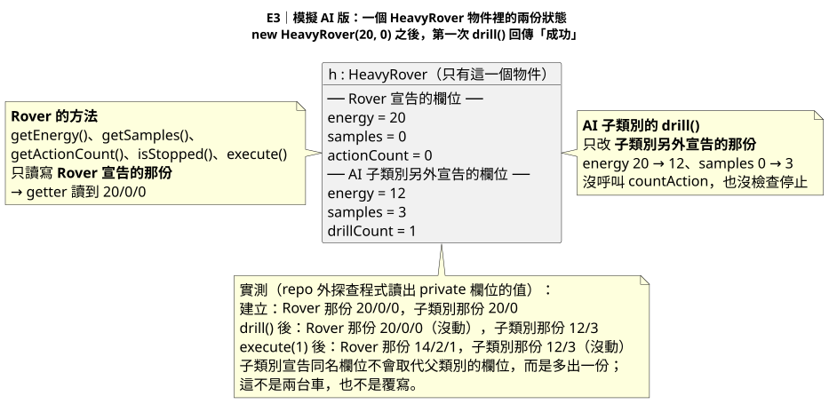

# 第七週實作報告：繼承與新增能力

姓名：曹臣緯　學號：A112222013　實際上課日期：2026/10/30　實際 JDK：openjdk 21.0.13.1（javac 21.0.13.1，Microsoft Build）

**教材說明**：老師的課程 repo（shuochenghu/115_1_Java_student）最新 commit 為 2026-11-19「修改week8」，與本機下載版本相同。第七週教材有 examples、starter、ai、diagrams 與投影片 `week07_slides_codex_claude.html`，但沒有 student_lab.md、assignment.md、DESIGN_template.md，本報告依投影片的講義題號 A–G 整理。

所有「實際」欄位都是本機實際執行的輸出。C 段實驗、B2 編譯判斷與自己的反例都放在 repo 外的暫存副本；`java-07/src` 只保留正確版。執行時加上 `-Dstdout.encoding=UTF-8`，避免 Windows 主控台把中文印成亂碼。

## A｜先備診斷

1. Rover 保存目前能源、樣本、行動次數並負責行動規則；Mission 負責執行腳本、停止與保存歷史；MissionStep 保存一步的只讀快照；MissionLog 是入口，負責固定腳本與報表。
2. 目前的 energy 是 Rover 現在的值；日誌裡某一步的 energy 是那一步行動後的快照，之後再行動也不會改。
3. 20 格、0 份跑 {1,1,2}：6/5/3 任務成功。
4. 執行 starter 原版：MemberDemo、MissionLog 都已完整（MissionLog 得 6/5/3 任務成功）；HeavyRoverTry 有 11 行「不符」，例如「鑽探: 尚未完成 （預期 成功） 不符」「鑽探後: 20/0/0/0 （預期 12/3/1/1） 不符」。舊任務成功不代表本週 TODO 完成。

環境：`java -version` 為 openjdk version "21.0.13.1" 2026-11-17 LTS；`javac -version` 為 javac 21.0.13.1。`java-07/src` 放 examples 三檔（Member、VipMember、MemberDemo）與 starter 六檔，在 `java-07` 執行 `javac -encoding UTF-8 -d out src/*.java`。

## B｜會員範例：extends

### B1 建構順序

| 項目 | 預測 | 實際 |
|---|---|---|
| 建立 Bob 時的輸出與先後 | 先「Member 建構子: Bob」，再「VipMember 建構子: Bob」 | 同左 |
| Amy 點數 | 120 / 10 = 12 | Amy 的點數=12 |
| Bob 點數／加贈次數 | 85 / 10 = 8，加贈 20 → 28；1 次 | Bob 的點數=28、Bob 的獎勵次數=1 |

完整輸出：

```text
Member 建構子: Amy
Member 建構子: Bob
VipMember 建構子: Bob
Amy 的點數=12
Bob 的點數=28
Bob 的獎勵次數=1
```

建立 Bob 只有一個物件：`super(name)` 先執行 Member 的建構子初始化「會員那部分」，再回到 VipMember 設定 bonusCount。建構子不會被繼承。

### B2 每一行單獨判斷（副本一次測一行）

| 呼叫 | 預測 | 副本實際編譯 |
|---|---|---|
| `bob.buy(50);` | 能：繼承 Member 的 buy | 編譯成功 |
| `bob.claimBonus();` | 能：VipMember 新增的方法 | 編譯成功 |
| `amy.claimBonus();` | 不能：Member 沒有 claimBonus | `error: cannot find symbol` |
| `bob.points = 99;` | 不能：points 是 Member 的 private 欄位 | `error: points has private access in Member` |

### B3 加贈可以連領兩次嗎？

全新 Bob：buy(85)，連續 claimBonus() 兩次。預測 8 + 20 + 20 = 48 點、bonusCount 2；副本實際印出 `48/2`。規格沒有「每天限一次」，不能自己補規則。

### B4 VipMember 沒寫 buy，為什麼能用？

buy 由 Member 實作，VipMember 繼承它；buy 更新的是 Member 宣告的 points。points 是 private，不被 VipMember 繼承，但 Bob 這個物件仍然有這份點數，由 Member 的方法負責存取。private 成員不被繼承，不等於子類別物件沒有那份資料。

### 對照範例 CompareMemberDemo（副本執行，不放進 src）

| 實驗 | 實際 |
|---|---|
| 原版 | 繼承版印兩行建構子訊息、不用繼承版印一行；兩者都是「點數=28, 獎勵次數=1」 |
| 實驗 1：Member 改成 price / 5 | 繼承版「點數=37」，不用繼承版仍「點數=28」：複製的那份不會跟著改 |
| 實驗 2：`Member asMember = inherited;` | 編譯成功 |
| 實驗 2：`Member notMember = standalone;` | `error: incompatible types: StandaloneVipMember cannot be converted to Member` |

## C｜三個隔離實驗（repo 外副本，做完不提交）

| 實驗 | 預測 | 實際 |
|---|---|---|
| C1 註解掉 VipMember 的 `super(name);` | 不能編譯：編譯器自動補無參數 `super()`，但 Member 只有 `Member(String)` | `error: constructor Member in class Member cannot be applied to given types; required: String found: no arguments` |
| C2 claimBonus 改成 `points += 20;` | 不能編譯：points 是 Member 的 private | `error: points has private access in Member` |
| C3 MemberDemo 兩次 buy 前加 `bob.addPoints(5);` | 能編譯，Bob 5 + 8 + 20 = 33 點 | Bob 的點數=33、Bob 的獎勵次數=1 |

C1 正確做法是寫回 `super(name)`，不是替 Member 補無參數建構子。C2 正確做法是用 Member 提供的 addPoints，不重複宣告 points，也不把欄位改成 protected。C3 能編譯是因為 MemberDemo 和 Member 在同一個套件：Java 的 protected 是「同套件＋子類別」，不是「只有子類別能用」（C# 的 protected 只開放給衍生類別）。

## D｜HeavyRover

### D1 is-a 或 has-a

| 類別 | 判斷與理由 |
|---|---|
| VipMember 與 Member | is-a：VIP 是一種會員，原有購物規則也適用 → 繼承 |
| HeavyRover 與 Rover | is-a：重型探測車是一種探測車，探索、掃描、充電照樣能用 → 繼承 |
| Mission 與 Rover | has-a：任務有一台車，任務本身不是車 → 欄位 |
| Mission 與 MissionStep | has-a：任務有多筆紀錄 → 欄位（清單） |

如果寫 `Mission extends Rover`，`mission.execute(1)`、`mission.getEnergy()` 都會變成合法呼叫，但任務不是一台車，不該有這些操作。

### D2 TODO 1：spendEnergy 與重構

`spendEnergy(int amount)`：`amount <= 0` 或 `amount > energy` 回傳 false、能源不變；其餘扣掉 amount 並回傳 true。它只守住扣能源規則，不負責停止、加樣本或計次。

- explore 依老師示範改成 `if (!spendEnergy(6)) { return "能源不足"; } addSamples(2); countAction(); return "成功";`
- scan 自己仿照改成 `spendEnergy(2)`、`addSamples(1)`、`countAction()`。
- charge 不是扣能源，維持原寫法。

D2-1：spendEnergy 回傳 boolean，呼叫端才知道是否成功；先檢查再扣，拒絕時能源才不會已經被改掉。

D2-2：scan 改完後任務輸出和改之前一模一樣，這**不能**證明真的改了——就算保留舊寫法，測試也會通過。要直接讀 explore、scan 的程式結構，確認已經改成呼叫三個 protected 方法。

### D3 TODO 2：HeavyRover 自己的狀態

新增 `private int drillCount;`，建構子在 `super(energy, samples)` 之後設 0，`getDrillCount()` 回傳它。`super(energy, samples)` 傳進去的兩個值由 Rover 保存，行動次數也在 Rover。

D3-1：為什麼不能另外宣告 energy、samples？因為那樣一個 HeavyRover 物件裡會有兩份 energy、samples：Rover 宣告的一份、子類別宣告的一份。getter 寫在 Rover 裡只讀 Rover 那份，子類別的方法卻改自己那份，兩邊就各改各的。

### D4 TODO 3：drill

```java
public String drill() {
    if (isStopped()) { return "任務已停止"; }
    if (!spendEnergy(DRILL_COST)) { return "能源不足"; }
    addSamples(DRILL_YIELD);
    countAction();
    drillCount++;
    return "成功";
}
```

drill 是新的公開入口，不經過 execute，所以要自己先檢查停止；能源不足時 spendEnergy 不扣，三項更新只在成功時才做。

D4-1 先追蹤再執行（全新 HeavyRover(20, 0)）：

| 呼叫 | 預測 回傳／energy／samples／actionCount／drillCount | 實際（HeavyRoverTry） |
|---|---|---|
| drill() | 成功／12／3／1／1 | 鑽探: 成功、鑽探後: 12/3/1/1 |
| execute(1) | 成功／6／5／2／1（樣本 5 已達標） | 探索: 成功、探索後: 6/5/2/1 |
| drill() | 任務已停止／6／5／2／1（不變） | 任務完成後鑽探: 任務已停止、完成後狀態維持: 6/5/2/1 |

D4-2 自己的反例：「只回成功卻沒更新狀態」。測試程式（repo 外副本）建立 `new HeavyRover(8, 2)` 鑽探一次，印出四個 getter 與是否停止，再鑽探一次。

| 版本 | 預期 | 實際 |
|---|---|---|
| 正確版 | 成功，0/5/1/1（能源剛好 8 用完、樣本剛好達 5，同時耗盡與達標），已停止=true；再鑽探回「任務已停止」 | 鑽探=成功, 狀態=0/5/1/1, 已停止=true；再鑽探=任務已停止 |
| 錯誤副本：drill 只寫 `return "成功";` | 回成功，但狀態應該要變 | 鑽探=成功, 狀態=8/2/0/0, 已停止=false；再鑽探=成功 |

理由：只看回傳字串，兩版都是「成功」；一定要讀 getter 才抓得到。選 8/2 是因為一次鑽探剛好讓能源歸零、樣本達標，正確版接著必須回「任務已停止」，錯誤版卻還能一直「成功」。

### D5 行為與圖

HeavyRoverTry 十五行全部「相符」：

```text
鑽探: 成功 （預期 成功） 相符
鑽探後: 12/3/1/1 （預期 12/3/1/1） 相符
探索: 成功 （預期 成功） 相符
探索後: 6/5/2/1 （預期 6/5/2/1） 相符
任務完成後鑽探: 任務已停止 （預期 任務已停止） 相符
完成後狀態維持: 6/5/2/1 （預期 6/5/2/1） 相符
能源不足: 能源不足 （預期 能源不足） 相符
能源不足時狀態維持: 7/0/0/0 （預期 7/0/0/0） 相符
能源剛好足夠: 成功 （預期 成功） 相符
能源剛好足夠時的狀態: 0/3/1/1 （預期 0/3/1/1） 相符
能源耗盡後無法充電: 任務已停止 （預期 任務已停止） 相符
初始能源為零: 任務已停止 （預期 任務已停止） 相符
耗盡後狀態維持: 0/0/0/0 （預期 0/0/0/0） 相符
初始已達標: 任務已停止 （預期 任務已停止） 相符
達標後狀態維持: 20/5/0/0 （預期 20/5/0/0） 相符
```

六條舊路線（每列在副本修改 MissionLog 的固定 script 後重新編譯；繳交版維持 {1,1,2}）：

| script | 預期 能源/樣本/行動、結果、步數/成功/拒絕/略過、次數、最低、電量 | 本人實際 | 相符 |
|---|---|---|---|
| {1,1,2} | 6/5/3 任務成功、3/3/0/0、[0,2,1,0]、6、30.0 | 同左 | 是 |
| {3,9,0} | 20/0/0 已返回、3/0/2/0、[1,0,0,1]、20、100.0 | 同左 | 是 |
| {0} | 20/0/0 已返回、1/0/0/0、[1,0,0,0]、20、100.0 | 同左 | 是 |
| {2,2,2,2,2} | 10/5/5 任務成功、5/5/0/0、[0,0,5,0]、10、50.0 | 同左 | 是 |
| {1,1,1,1} | 2/6/3 任務成功、3/3/0/1、[0,3,0,0]、2、10.0 | 同左 | 是 |
| {2,1} | 12/3/2 任務未完成、2/2/0/0、[0,1,1,0]、12、60.0 | 同左 | 是 |

```text
######## script={1, 1, 2}
=== 任務回放 ===
步驟 1: 指令=1, 結果=成功, 能源=14
步驟 2: 指令=1, 結果=成功, 能源=8
步驟 3: 指令=2, 結果=成功, 能源=6
指令次數[0..3]=[0, 2, 1, 0]
步數=3, 成功=3, 拒絕=0, 略過=0
最低能源=6
最終能源=6, 樣本數=5, 行動次數=3 -> 任務成功
電量百分比=30.0
######## script={3, 9, 0}
=== 任務回放 ===
步驟 1: 指令=3, 結果=能源已滿, 能源=20
步驟 2: 指令=9, 結果=無效指令, 能源=20
步驟 3: 指令=0, 結果=返回, 能源=20
指令次數[0..3]=[1, 0, 0, 1]
步數=3, 成功=0, 拒絕=2, 略過=0
最低能源=20
最終能源=20, 樣本數=0, 行動次數=0 -> 已返回
電量百分比=100.0
######## script={0}
=== 任務回放 ===
步驟 1: 指令=0, 結果=返回, 能源=20
指令次數[0..3]=[1, 0, 0, 0]
步數=1, 成功=0, 拒絕=0, 略過=0
最低能源=20
最終能源=20, 樣本數=0, 行動次數=0 -> 已返回
電量百分比=100.0
######## script={2, 2, 2, 2, 2}
=== 任務回放 ===
步驟 1: 指令=2, 結果=成功, 能源=18
步驟 2: 指令=2, 結果=成功, 能源=16
步驟 3: 指令=2, 結果=成功, 能源=14
步驟 4: 指令=2, 結果=成功, 能源=12
步驟 5: 指令=2, 結果=成功, 能源=10
指令次數[0..3]=[0, 0, 5, 0]
步數=5, 成功=5, 拒絕=0, 略過=0
最低能源=10
最終能源=10, 樣本數=5, 行動次數=5 -> 任務成功
電量百分比=50.0
######## script={1, 1, 1, 1}
=== 任務回放 ===
步驟 1: 指令=1, 結果=成功, 能源=14
步驟 2: 指令=1, 結果=成功, 能源=8
步驟 3: 指令=1, 結果=成功, 能源=2
指令次數[0..3]=[0, 3, 0, 0]
步數=3, 成功=3, 拒絕=0, 略過=1
最低能源=2
最終能源=2, 樣本數=6, 行動次數=3 -> 任務成功
電量百分比=10.0
######## script={2, 1}
=== 任務回放 ===
步驟 1: 指令=2, 結果=成功, 能源=18
步驟 2: 指令=1, 結果=成功, 能源=12
指令次數[0..3]=[0, 1, 1, 0]
步數=2, 成功=2, 拒絕=0, 略過=0
最低能源=12
最終能源=12, 樣本數=3, 行動次數=2 -> 任務未完成
電量百分比=60.0
```

繼承圖：`diagrams/heavy_practice.puml` 補上 Rover 的三個 `#` 方法、HeavyRover 的兩個常數、drillCount、建構子、getDrillCount、drill，以及 `Rover <|-- HeavyRover`；不畫 Mission→HeavyRover（Mission 程式沒用到它）。用 `java -jar C:\Users\qkall\ClassTools\plantuml.jar -charset UTF-8 -tsvg diagrams\heavy_practice.puml` 重新產生 SVG，並以 PNG 預覽確認三角形指向 Rover。

## E｜模擬 AI 回覆（ai/HeavyRover.java，教師模擬，非真實 AI 對話）

### E1 先預測（寫完 D 段後、看執行結果前，先 commit）

- 能編譯嗎？能。子類別有寫 `super(energy, samples)`，又自己宣告了 private 的 energy、samples，語法都合法。
- 第一次 `drill()` 之後 `getEnergy()` 讀到多少？預測還是 **20**。getEnergy 寫在 Rover 裡，讀的是 Rover 宣告的那份；AI 的 drill 改的是子類別自己另外宣告的那份（20→12），兩份互不相干。drill 會回「成功」，但 getSamples 仍是 0，行動次數也不會加（沒有呼叫 countAction）。
- 預測另外兩個問題：drill 沒有檢查停止，初始就達標的車也能「成功」；而且子類別那份能源自己扣，Rover 那份沒扣，原本應該耗盡的車用 execute(3) 還能充電。

以上預測已在 commit `fa0c55f` 中先提交，之後才執行 AI 版。

### E2 在 ai-check 實際執行

把完成的 Rover、HeavyRoverTry 和**未修改**的 AI HeavyRover 放進 `java-07/ai-check`，單獨編譯（不混正式 src），先用 `[AI]` commit `0f597ec` 保留原文。能編譯，HeavyRoverTry 完整輸出：

```text
鑽探: 成功 （預期 成功） 相符
鑽探後: 20/0/0/1 （預期 12/3/1/1） 不符
探索: 成功 （預期 成功） 相符
探索後: 14/2/1/1 （預期 6/5/2/1） 不符
任務完成後鑽探: 成功 （預期 任務已停止） 不符
完成後狀態維持: 14/2/1/2 （預期 6/5/2/1） 不符
能源不足: 能源不足 （預期 能源不足） 相符
能源不足時狀態維持: 7/0/0/0 （預期 7/0/0/0） 相符
能源剛好足夠: 成功 （預期 成功） 相符
能源剛好足夠時的狀態: 8/0/0/1 （預期 0/3/1/1） 不符
能源耗盡後無法充電: 成功 （預期 任務已停止） 不符
初始能源為零: 能源不足 （預期 任務已停止） 不符
耗盡後狀態維持: 0/0/0/0 （預期 0/0/0/0） 相符
初始已達標: 成功 （預期 任務已停止） 不符
達標後狀態維持: 20/5/0/1 （預期 20/5/0/0） 不符
```

共 9 行不符。和預測比對：

| 指定行 | 實際 | 和我的預測 |
|---|---|---|
| 鑽探後 | 20/0/0/1：回「成功」，但 getter 讀到的能源、樣本、行動數都沒變，只有 drillCount 變 1 | 符合預測：getEnergy 仍是 20，行動次數沒加 |
| 任務完成後鑽探 | 「成功」：Rover 那份是 14/2 還沒停止；AI 的 drill 沒有檢查停止，用的又是子類別那份 12 格能源 | 符合預測的「沒有停止檢查」；而且因為兩份狀態，連「任務完成」本身都沒發生（Rover 那份樣本只有 2） |
| 能源耗盡後無法充電 | 「成功」：8 格的車 drill 後，子類別那份變 0，但 Rover 看到的能源仍是 8，所以 execute(3) 充電成功；本來應該已耗盡、回「任務已停止」 | 符合預測 |

### E3 一個物件裡的兩份狀態

物件圖（`java-07/diagrams/ai_two_states.puml`，以 PlantUML 產生 SVG）：



用 repo 外的探查程式（反射讀 private 欄位，只用來觀察）追蹤 `new HeavyRover(20, 0)`：

| 動作 | Rover 宣告的 能源/樣本/行動 | AI 子類別另宣告的 能源/樣本 | getter 讀到 |
|---|---|---|---|
| 建立 | 20 / 0 / 0 | 20 / 0 | 20 / 0 / 0 |
| drill()，回「成功」 | 20 / 0 / 0（沒動） | 12 / 3 | 20 / 0 / 0 |
| execute(1)，回「成功」 | 14 / 2 / 1 | 12 / 3（沒動） | 14 / 2 / 1 |

這是**一台**車、一個物件，不是兩台車，也不是覆寫。`getEnergy()`、`getSamples()` 寫在 Rover 裡，只讀 Rover 那份；AI 的 `drill()` 改的是子類別另外宣告的那份，所以各改各的。

### E4 最小修正（`[fix]` commit `e551194`）

1. 只先刪掉子類別的 `energy`、`samples` 欄位與建構子裡的 `this.energy = …`、`this.samples = …`，編譯出現 3 個錯誤：`energy has private access in Rover`（兩處）、`samples has private access in Rover`。這是提示要改用 Rover 的 protected 方法，不是把欄位改成 protected。
2. drill 改成先 `isStopped()`，再 `spendEnergy(8)`，成功才 `addSamples(3)`、`countAction()`、`drillCount++`。

重測 ai-check 的 HeavyRoverTry：十五行全部「相符」（與 D5 輸出相同）。正式 src 的 {1,1,2}、{3,9,0} 也重測過，見 D5。

### E5 補強 Prompt

> 請寫一個繼承 Rover 的 HeavyRover，新增 drill()：耗 8 格能源、得 3 份樣本、行動次數加 1，並記錄鑽探次數。Rover 的 energy、samples、actionCount 是 private，**狀態只能有一份**，不可在子類別重新宣告同名欄位，也不要把欄位改成 protected；請改用 Rover 提供的 public 方法 isStopped()、getEnergy()、getSamples()、getActionCount()，以及 protected 方法 spendEnergy(int)、addSamples(int)、countAction()。drill 是新的公開入口、不經過 execute，必須先檢查停止（停止優先，回「任務已停止」）；能源不足回「能源不足」且狀態全部不變。不可覆寫父類別任何方法。請附一個能抓出「只回成功卻沒更新狀態」的反例與預期值。

來源：本 Prompt 是我依教師模擬情境補強的版本，沒有實際送到其他 AI 服務。

## 課後獨立遷移：CargoRover（路線 A）

在 src 新增自己的 `CargoRover.java` 與 `CargoRoverTry.java`。規格與完整測試表見 [DESIGN.md](java-07/DESIGN.md) 第 4 節。CargoRoverTry 完整輸出：

```text
裝 2: 成功/2 （預期 成功/2） 相符
再裝 2（只剩 1 格）: 已拒絕/2 （預期 已拒絕/2） 相符
裝 1 剛好滿載: 成功/3 （預期 成功/3） 相符
裝 0: 已拒絕/3 （預期 已拒絕/3） 相符
滿載後再裝 1: 已拒絕/3 （預期 已拒絕/3） 相符
原有三個 getter: 20/0/0 （預期 20/0/0） 相符
裝 -1: 已拒絕/0 （預期 已拒絕/0） 相符
一次裝 3 剛好滿載: 成功/3 （預期 成功/3） 相符
一次裝 4 超過容量: 已拒絕/0 （預期 已拒絕/0） 相符
能源耗盡時裝貨: 任務已停止/0 （預期 任務已停止/0） 相符
已達標時裝貨: 任務已停止/0 （預期 任務已停止/0） 相符
裝 2 後探索: 成功/14/2/1/2 （預期 成功/14/2/1/2） 相符
```

涵蓋正常、邊界（剛好滿載、一次裝滿）、拒絕（0、負數、超量）與停止（耗盡、達標）。在 repo 外副本拿掉 load 的停止檢查後，「能源耗盡時裝貨」「已達標時裝貨」變成「成功/1 … 不符」，證明這兩個案例抓得到漏掉停止檢查的錯誤。

## F｜課末檢核

1. private 欄位不被繼承，為什麼 `getEnergy()` 仍讀得到父類別那份狀態？getEnergy 是 Rover 自己的方法，存取的是 Rover 自己宣告的 energy；HeavyRover 物件裡本來就有這份資料，只是子類別的程式不能直接碰。
2. protected 方法會自動保證 drill 遵守停止與計次嗎？不會。spendEnergy 只管扣能源，countAction 要自己呼叫，停止也要 drill 自己先檢查。
3. 子類別建構子會繼承父類別建構子嗎？不會，HeavyRover 要寫自己的建構子，再用 `super(energy, samples)` 呼叫 Rover 的。
4. 同套件其他類別能呼叫 spendEnergy 嗎？能，Java 的 protected 包含同套件。但這樣會繞過行動流程（不會加樣本、計次、記日誌），讓歷史、計次與停止不一致，所以課程限制只在行動方法裡使用。
5. `HeavyRover.execute(1)` 現在得到幾份？仍是 2 份。本週新增的是 drill（耗 8 得 3），沒有改探索；要讓探索得 3 份需要覆寫，那是第八週的內容，所以本週新增 drill 不算達成「探索得 3 份」。

F2 自查圖：三角形指向父類別 Rover；三個 `#` 方法與程式的 protected 一致；HeavyRover 只列新增成員；Mission 仍關聯 Rover，沒有 Mission→HeavyRover。

F3：課後遷移選 CargoRover，新增 private cargo、load 方法與 super 建構子，規則是容量 3、不耗能源、停止時拒絕。

## G｜繳交與保存

- [x] 重新編譯，跑 MemberDemo、MissionLog、HeavyRoverTry、CargoRoverTry；MissionLog 的 script 為預設 {1,1,2}。
- [x] `heavy_practice.puml` 與 SVG 同步。
- [x] `[AI]` 原文（`0f597ec`）與 `[fix]` 修正（`e551194`）兩個 commit 可比較。
- [x] `java-07/src` 共 11 檔：examples 3＋starter 6＋自己的 CargoRover、CargoRoverTry；`ai-check` 有完成的 Rover、修正後 AI HeavyRover、HeavyRoverTry。out、jar、.idea、*.iml、C 段錯誤副本都不提交。
- [x] push 後在 GitHub 核對：2026-11-27 push 到 origin/main，最新為 `11f202e`；`diagrams/heavy_practice.svg` 在 GitHub 以 image/svg+xml 正常提供。
- [x] 另一位置 clone，編譯並跑 HeavyRoverTry：從 GitHub clone 到另一個本機暫存資料夾（原副本未刪），HEAD 為 `11f202e`；JDK 21.0.13.1；`src` 有 11 檔，src 與 ai-check 分開編譯成功。HeavyRoverTry 15/15 相符、CargoRoverTry 12/12 相符、ai-check 的 HeavyRoverTry 15/15 相符；MissionLog 得「最終能源=6, 樣本數=5, 行動次數=3 -> 任務成功」「電量百分比=30.0」。

最終 commit：第七週作業 `fa0c55f`（D 段）、`0f597ec`（[AI]）、`e551194`（[fix]）、`11f202e`（遷移與報告）；本段驗證紀錄另以後續 commit 補上。

IntelliJ IDEA：本週投影片寫「可示範」，非必做；本週沒有用 IDEA 操作。
