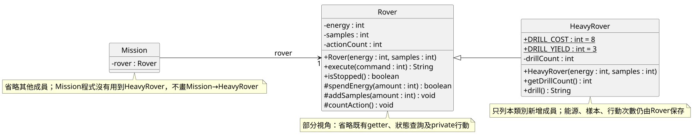
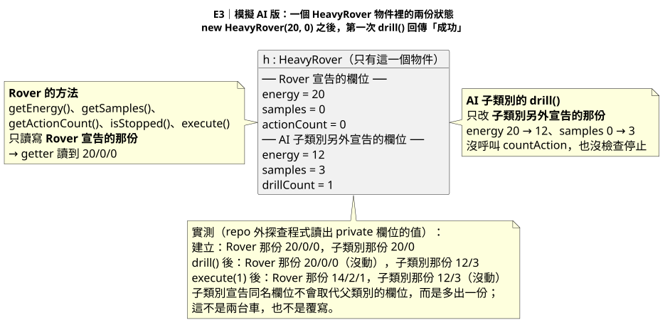

# 第七週設計文件：繼承與新增能力

> 老師發布的第七週學生教材沒有附 `DESIGN_template.md`，本文件依投影片 G 段規定的內容（圖、is-a 理由、遷移規格與測試）整理。
> 圖用 PlantUML 1.2026.10 產生：`java -jar C:\Users\qkall\ClassTools\plantuml.jar -charset UTF-8 -tsvg diagrams\heavy_practice.puml`。

## 1. 繼承圖（D1、D5）

- 空心三角形的實線指向父類別 Rover：`Rover <|-- HeavyRover`。
- Rover 補上本週新增的三個 protected 方法（UML 的 `#`）：spendEnergy、addSamples、countAction。
- HeavyRover 只列本類別新增的成員：兩個 static 常數（底線）、private drillCount、建構子、getDrillCount、drill。繼承來的 execute、getter 不再畫一次。
- Mission 仍只關聯 Rover（欄位 `rover`）。Mission 的程式沒有用到 HeavyRover，所以不畫 Mission→HeavyRover。
- 這是部分視角：Rover 省略既有 getter、狀態查詢及 private 行動，圖上沒畫不代表不存在。

## 2. is-a 與 has-a

| 類別 | 關係 | 理由 |
|---|---|---|
| HeavyRover 與 Rover | is-a → 繼承 | 重型探測車是一種探測車；探索、掃描、充電、停止規則都照樣適用 |
| CargoRover 與 Rover | is-a → 繼承 | 貨運探測車也是一種探測車，只是多了貨艙 |
| Mission 與 Rover | has-a → 欄位 | 任務有一台車；任務不是車，不能 `Mission extends Rover`，否則 `mission.execute(1)` 這種不合理呼叫會變合法 |
| Mission 與 MissionStep | has-a → 欄位 | 任務有多筆紀錄 |

## 3. 為什麼用 protected 方法，而不是 protected 欄位或重複宣告

- Rover 的 energy、samples、actionCount 維持 private。子類別透過 `spendEnergy`、`addSamples`、`countAction` 改 Rover 那一份狀態，規則（例如能源不足不扣）只寫在 Rover 一個地方。
- 子類別如果再宣告一次 energy、samples（E 段模擬 AI 的錯），一個物件裡就有兩份狀態：getter 讀 Rover 那份、子類別方法改自己那份，回傳「成功」卻看不到變化。
- 下圖是 E 段模擬 AI 版實測的物件狀態（`diagrams/ai_two_states.puml`）：

- protected 方法不會自動保證停止或計次。新的公開入口（drill、load）不經過 execute，必須自己先呼叫 `isStopped()`。

## 4. 課後獨立遷移：CargoRover（路線 A）

### 規格

- `CargoRover extends Rover`；建構子 `CargoRover(int energy, int samples)`，第一行 `super(energy, samples)`。
- `private int cargo`，初始 0，`getCargo()` 回傳；容量固定 `CAPACITY = 3`。貨物不是科學樣本。
- `String load(int amount)`：
  - 已停止（耗盡或達標）→「任務已停止」，貨物不變。
  - `amount <= 0` 或 `amount > CAPACITY - cargo` →「已拒絕」，貨物不變。
  - 其餘 → cargo 增加 amount，回「成功」。
- 裝貨不耗能源、不加樣本、不加 actionCount。用 `amount > CAPACITY - cargo` 而不是先相加再判斷。

### 測試（CargoRoverTry，十二項全部相符）

| 案例 | 預期 回傳/貨物 |
|---|---|
| (20,0) load(2) | 成功/2 |
| 接著 load(2)，只剩 1 格 | 已拒絕/2 |
| 接著 load(1)，剛好滿載 | 成功/3 |
| 接著 load(0) | 已拒絕/3 |
| 滿載後 load(1) | 已拒絕/3 |
| 原有三個 getter | 20/0/0（裝貨不影響能源、樣本、行動次數） |
| 新車 load(-1) | 已拒絕/0 |
| 新車 load(3) 一次裝滿 | 成功/3 |
| 新車 load(4) 超過容量 | 已拒絕/0 |
| (0,0) load(1) | 任務已停止/0 |
| (20,5) load(1) | 任務已停止/0 |
| (20,0) load(2) 後 execute(1) | 成功，能源/樣本/行動/貨物 = 14/2/1/2 |

驗證測試有效：在 repo 外副本拿掉 load 的停止檢查，「能源耗盡時裝貨」「已達標時裝貨」兩行變成「成功/1 … 不符」。
