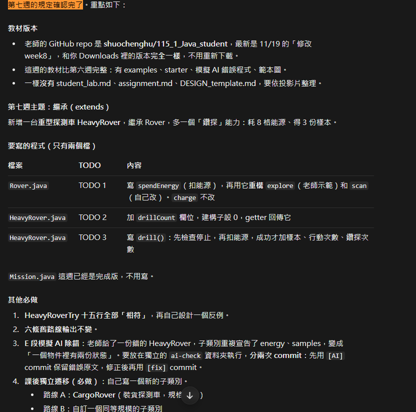
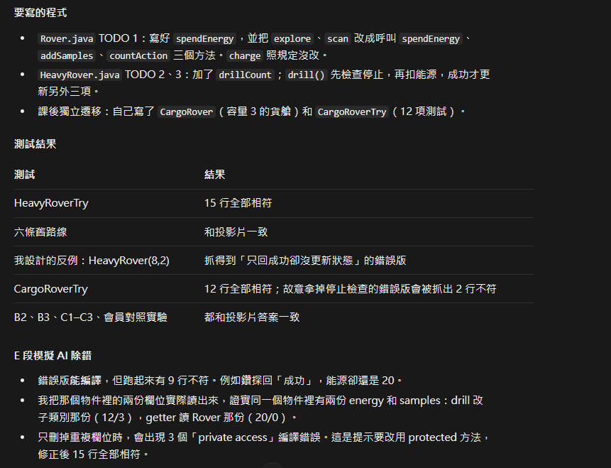
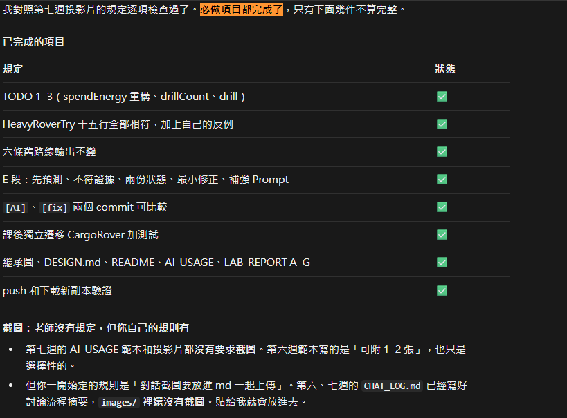

# 第七週與 AI 的討論過程

使用工具：Claude Code。

## 討論流程摘要

1. 我請 AI 先去看老師 GitHub 上第七週的規定再確認一次。AI 找到老師的課程 repo（shuochenghu/115_1_Java_student），確認最新 commit 與我下載的教材相同，也確認第六週缺的 examples 在 GitHub 上同樣沒有。
2. AI 讀完第七週的投影片、examples、starter、模擬 AI 程式與範本圖，整理出規定：要寫 Rover 的 TODO 1 與 HeavyRover 的 TODO 2、3；E 段要分 `[AI]`、`[fix]` 兩個 commit；課後獨立遷移必做。遷移題 AI 依建議選路線 A：CargoRover。
3. AI 先跑 starter 原版確認起點，再完成 TODO 1–3，跑 HeavyRoverTry 十五行、六條舊路線、B2、B3、C1–C3 與會員對照實驗，並設計自己的反例 HeavyRover(8,2)。
4. 依投影片順序 commit：先提交 D 段完成碼與 E1 預測，再放入原封不動的模擬 AI 版並 `[AI]` commit，執行看到 9 行不符、用探查程式證實一個物件裡有兩份狀態，最小修正後 `[fix]` commit。
5. AI 寫 CargoRover 與十二項測試，並用拿掉停止檢查的錯誤副本確認測試有效；最後補繼承圖、DESIGN.md、README、AI_USAGE 與 LAB_REPORT。
6. 推送後 AI 另外 clone 新副本驗證，補上 G 段。我問「第七週的規則都完成了嗎、需不需要截圖」，AI 逐項對照投影片檢查，指出姓名欄未填、E3 投影片要求「畫」出兩份狀態、評分要求本人驗證。我自己在 VS Code 補上三到七週的姓名，AI 補畫 E3 兩份狀態物件圖。

## 截圖

以下為當時對話的原始截圖（不是事後重新輸出的內容）。

### 1. 確認老師 GitHub 上的第七週規定

### 2. 第七週完成回報與 E 段模擬 AI 除錯

### 3. 我追問規則是否都完成，AI 逐項檢查

## 日期更正（2026-11-27）

本週資料夾原本命名為 `2026_10_30`，是 AI 依「每週五上課、往後推一週」推算的，沒有考慮 10/09、10/23 放假與實際進度。我核對課表後告訴 AI 正確的上課日期，AI 對照老師 GitHub 上傳教材的時間後，把資料夾改名為 `2026_11_20`（用 git mv 保留 commit 歷史），並更正 LAB_REPORT、AI_USAGE 的日期與路徑。上方流程摘要保留當時的原始紀錄，沒有改寫。
