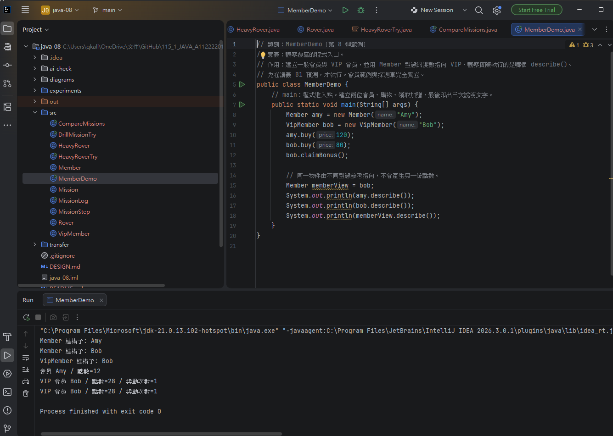
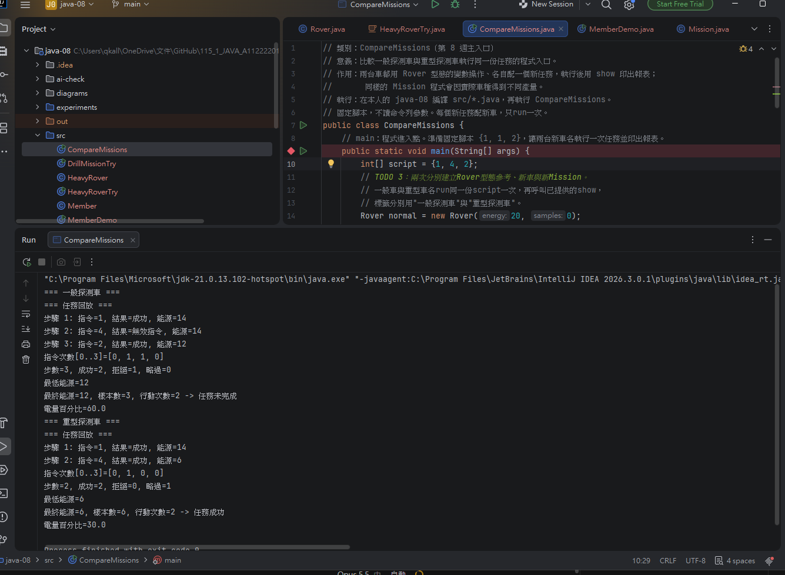

# 第八週實作報告：覆寫與多型基礎

姓名：曹臣緯　學號：A112222013　實際上課日期：2026/11/27　實際 JDK：openjdk 21.0.13.1（javac 21.0.13.1，Microsoft Build）

**教材說明**：老師課程 repo（shuochenghu/115_1_Java_student）於 2026-11-27 14:35 補上第八週 AI_USAGE 範本，本週使用此最新版。第八週教材有 examples、starter、ai、diagrams 與投影片 `week08_slides_codex_claude.html`，沒有 student_lab.md、assignment.md，本報告依投影片的講義題號 A–G 整理。

所有「實際」欄位都是本機實際執行的輸出。B、C 段編譯錯誤實驗與 E3 實驗都在 repo 外的暫存副本；`java-08/src` 只保留正確版。

## A｜前週診斷

1. 第七週 HeavyRover 呼叫 `execute(1)` 得 **2 份**。drill() 是另外新增的入口，execute 走的仍是 Rover 的 private explore，產量 2 寫死在裡面，所以 drill 沒有改變探索。
2. Rover 保存目前狀態與行動規則；Mission 讀腳本、判斷停止、保存歷史；MissionStep 是一步行動後的只讀快照。目前狀態會一直變，歷史快照之後不會被改。
3. 子類別不能直接讀寫 Rover 的 private samples，要用 Rover 提供的方法。protected 不是「只有子類別能用」，Java 的 protected 也允許同套件存取；本課程約定只由行動實作使用。
4. `java -version`：openjdk version "21.0.13.1" 2026-11-17 LTS；`javac -version`：javac 21.0.13.1。本週五個 main 入口：MemberDemo、MissionLog、HeavyRoverTry、CompareMissions、DrillMissionTry。

起點：把 examples 三檔與 starter 八檔放進 `java-08/src`（11 檔）並執行 starter 原版：MissionLog 正常（6/5/3 任務成功）；HeavyRoverTry 有 2 行不符（探索後: 6/5/2/1 預期 6/6/2/1）；DrillMissionTry 有 4 行不符（例如「重型車：指令4的結果: 無效指令 （預期 成功）」）；CompareMissions 印「尚未完成：請建立兩個獨立任務」。能編譯不等於已完成。

## B｜會員覆寫範例

### B1 預測與實際

| 項目 | 預測 | 實際 |
|---|---|---|
| 建構訊息 | Member 建構子: Amy → Member 建構子: Bob → VipMember 建構子: Bob（只有三行） | 同左 |
| amy、bob 點數 | Amy 120÷10=12；Bob 80÷10=8，領獎勵 +20=28 | 同左 |
| 三次 describe() | 會員 Amy / 點數=12；VIP 會員 Bob / 點數=28 / 獎勵次數=1（兩次） | 同左 |
| memberView.describe() 用哪個版本 | VipMember 的版本 | 同左 |

```text
Member 建構子: Amy
Member 建構子: Bob
VipMember 建構子: Bob
會員 Amy / 點數=12
VIP 會員 Bob / 點數=28 / 獎勵次數=1
VIP 會員 Bob / 點數=28 / 獎勵次數=1
```

`memberView = bob` 只是多了一個參考，指向同一個 VipMember 物件：不會再跑一次建構子，也不會多一份點數。memberView 的型態寫 Member，但物件本身仍是 VIP，所以執行 VIP 的 describe()。

### B2 @Override 在檢查什麼（副本）

| 實驗 | 實際 |
|---|---|
| VIP 方法改名 `describeVIP`，保留 `@Override` | `error: method does not override or implement a method from a supertype` |
| 改名 `describeVIP`，拿掉 `@Override` | 能編譯；三次 describe() 都變成父類別版本：會員 Amy / 點數=12、會員 Bob / 點數=28（兩次） |

`@Override` 本身不製造多型；它讓「打錯簽名」從執行時的怪結果，變成編譯時就報錯。

### B3 super.describe()（副本）

預期最後三行：會員 Amy / 點數=12、會員 Bob / 點數=28 / VIP（兩次），建構訊息三行不變。把 VIP 的 describe 改成 `return super.describe() + " / VIP";` 後實際輸出相同。`super.describe()` 不會建立另一個 Member 物件：父類別版本讀的 name、points 就存在同一個 Bob 物件裡。

## C｜宣告型態與實際物件

### C1

| 變數 | 宣告型態 | 實際物件 | 能呼叫 describe？ | 執行哪個 |
|---|---|---|---|---|
| bob | VipMember | VipMember | 能 | VIP 版 |
| memberView | Member | VipMember | 能 | VIP 版 |

### C2 三個單獨實驗（副本，每次只改一處）

| 實驗 | 預測 | 實際 |
|---|---|---|
| `memberView.claimBonus();` | 不能編譯：Member 沒有宣告 claimBonus | `error: cannot find symbol`，`location: variable memberView of type Member` |
| `memberView.describe();` | 能編譯，執行 VIP 版 | 同 B1 的第三行 |
| VIP 改成 `describe(int amount)`，保留 `@Override` | 不能編譯：參數不同就不是覆寫 | `error: method does not override or implement a method from a supertype` |

### C3

編譯時看**宣告型態**：memberView 是 Member，只能呼叫 Member 有宣告的方法。執行時看**實際物件**：memberView 實際是 VipMember，可覆寫的實例方法執行 VIP 的版本。這條規則只適用可覆寫的實例方法；欄位、static 方法、private 方法不會依實際物件選版本。

## D｜探測車：讓重型車探索得 3 份

### D1 責任與呼叫追蹤

Mission 的欄位型態是 Rover，實際放進去的是 HeavyRover：
1. `execute(1)`：未停止 → case 1（Rover）
2. `explore()`：扣 6 格（Rover，private）
3. `exploreYield()`：**依實際物件**，HeavyRover 回 3
4. `addSamples(3)`、`countAction()`（Rover）

只有第 3 步會因車種不同而不同。D1-1：如果只在 HeavyRover 加一個同名 private explore()，第 2 步**不會**走到它。父類別的 private 方法不被繼承、也不能覆寫，Rover.execute 只認得 Rover 自己的 explore（E 段實測證實）。

### D2 TODO 1

Rover 的 explore 只改一行：`addSamples(2);` → `addSamples(exploreYield());`，扣能源、拒絕、countAction、回傳值都保留。

檢查點：MissionLog 仍是 `最終能源=6, 樣本數=5, 行動次數=3 -> 任務成功`；HeavyRoverTry 仍有 2 行不符（探索後: 6/5/2/1），因為 HeavyRover 還沒覆寫產量方法，繼承的版本仍回 2。這是正常的。

### D3 TODO 2

```java
@Override
protected int exploreYield() {
    return 3;
}
```

存取權和父類別一樣是 protected（不可更嚴；副本實測改成 private 會出現 `attempting to assign weaker access privileges; was protected`），回傳 int、名稱與參數相同。只回傳產量，不扣能源、不加樣本、不計次。

全新 `HeavyRover(20, 0)` 預測與實際：

| 呼叫 | 回傳 | energy | samples | actionCount | drillCount |
|---|---|---|---|---|---|
| drill() | 成功 | 12 | 3 | 1 | 1 |
| execute(1) | 成功 | 6 | 6 | 2 | 1 |
| drill() | 任務已停止 | 6 | 6 | 2 | 1 |

探索 12−6=6 格、3+3=6 份；6 ≥ 5 成功停止，第二次 drill 不改任何狀態。actionCount 只加 1，因為計次仍由父類別 explore 做一次。HeavyRoverTry 15 行全部「相符」：

```text
鑽探: 成功 （預期 成功） 相符
鑽探後: 12/3/1/1 （預期 12/3/1/1） 相符
探索: 成功 （預期 成功） 相符
探索後: 6/6/2/1 （預期 6/6/2/1） 相符
任務完成後鑽探: 任務已停止 （預期 任務已停止） 相符
完成後狀態維持: 6/6/2/1 （預期 6/6/2/1） 相符
能源不足: 能源不足 （預期 能源不足） 相符
能源不足時狀態維持: 7/0/0/0 （預期 7/0/0/0） 相符
能源剛好足夠: 成功 （預期 成功） 相符
能源剛好足夠時的狀態: 0/3/1/1 （預期 0/3/1/1） 相符
能源耗盡後無法充電: 任務已停止 （預期 任務已停止） 相符
初始能源為零: 任務已停止 （預期 任務已停止） 相符
耗盡後狀態維持: 0/0/0/0 （預期 0/0/0/0） 相符
初始已達標: 任務已停止 （預期 任務已停止） 相符
達標後狀態維持: 20/5/0/0 （預期 20/5/0/0） 相符
```

### D4 TODO 3：CompareMissions

兩個參考都宣告為 Rover：`Rover normal = new Rover(20, 0);`、`Rover heavy = new HeavyRover(20, 0);`，各配自己的 `new Mission(...)`、各 `run(script)` 一次，再各呼叫 show 一次。沒有用 if 判斷車種，沒有改 Mission，也沒有把同一台車交給兩個任務。

### D5 兩車結果

```text
=== 一般探測車 ===
=== 任務回放 ===
步驟 1: 指令=1, 結果=成功, 能源=14
步驟 2: 指令=1, 結果=成功, 能源=8
步驟 3: 指令=2, 結果=成功, 能源=6
指令次數[0..3]=[0, 2, 1, 0]
步數=3, 成功=3, 拒絕=0, 略過=0
最低能源=6
最終能源=6, 樣本數=5, 行動次數=3 -> 任務成功
電量百分比=30.0
=== 重型探測車 ===
=== 任務回放 ===
步驟 1: 指令=1, 結果=成功, 能源=14
步驟 2: 指令=1, 結果=成功, 能源=8
指令次數[0..3]=[0, 2, 0, 0]
步數=2, 成功=2, 拒絕=0, 略過=1
最低能源=8
最終能源=8, 樣本數=6, 行動次數=2 -> 任務成功
電量百分比=40.0
```

重型車第二次探索後已有 6 份，Mission 下一輪先查停止，所以不讀掃描；指令次數、最低能源、電量都因此不同。這是各自一次完整任務的比較，不能為了「同樣讀三筆」取消停止規則。

### D5 補充：CompareMissions 換其他腳本比較

依老師課堂說明，把 CompareMissions 的 `int[] script = {1, 1, 2};` 換成其他腳本測試並保存結果。每組都在 repo 外副本修改 script 後重新編譯；繳交版維持 {1, 1, 2}。

| script | 一般車 能源/樣本/行動、結果、步數/略過 | 重型車 能源/樣本/行動、結果、步數/略過 | 觀察 |
|---|---|---|---|
| {2,2,2,2,2} | 10/5/5 任務成功，5 步／略過 0 | 10/5/5 任務成功，5 步／略過 0 | 只掃描時兩車完全相同：覆寫只影響探索產量，掃描仍用父類別規則 |
| {3,9,0} | 20/0/0 已返回，3 步／略過 0 | 20/0/0 已返回，3 步／略過 0 | 能源已滿、無效指令、返回兩車相同 |
| {1,1,1,1} | 2/6/3 任務成功，3 步／略過 1 | 8/6/2 任務成功，2 步／略過 2 | 重型車第 2 次探索就達標，少讀一筆 |
| {2,1} | 12/3/2 任務未完成，2 步 | 12/4/2 任務未完成，2 步 | 都未達標，樣本只差探索的 1 份；能源與行動次數相同（成本不變） |
| {1,3,1} | 13/4/3 任務未完成，3 步 | 13/6/3 任務成功，3 步 | 同樣三步、同樣能源，只因探索產量不同而結果不同 |
| {4,1} | 14/2/1 任務未完成，2 步（指令 4 為無效指令） | 6/6/2 任務成功，2 步（指令 4 鑽探） | 指令 4 只有覆寫了 execute 的重型車認得；Mission 沒改 |
| {4,4,2} | 18/1/1 任務未完成，3 步（兩個無效指令） | 4/6/2 任務成功，2 步／略過 1 | 連續鑽探兩次（8+8 格、3+3 份）就達標；指令次數 [0,0,0,0]，因為 countCommands 只統計 0～3 |

<details>
<summary>七組腳本的完整輸出（展開）</summary>

```text
################ script={2, 2, 2, 2, 2}
=== 一般探測車 ===
=== 任務回放 ===
步驟 1: 指令=2, 結果=成功, 能源=18
步驟 2: 指令=2, 結果=成功, 能源=16
步驟 3: 指令=2, 結果=成功, 能源=14
步驟 4: 指令=2, 結果=成功, 能源=12
步驟 5: 指令=2, 結果=成功, 能源=10
指令次數[0..3]=[0, 0, 5, 0]
步數=5, 成功=5, 拒絕=0, 略過=0
最低能源=10
最終能源=10, 樣本數=5, 行動次數=5 -> 任務成功
電量百分比=50.0
=== 重型探測車 ===
=== 任務回放 ===
步驟 1: 指令=2, 結果=成功, 能源=18
步驟 2: 指令=2, 結果=成功, 能源=16
步驟 3: 指令=2, 結果=成功, 能源=14
步驟 4: 指令=2, 結果=成功, 能源=12
步驟 5: 指令=2, 結果=成功, 能源=10
指令次數[0..3]=[0, 0, 5, 0]
步數=5, 成功=5, 拒絕=0, 略過=0
最低能源=10
最終能源=10, 樣本數=5, 行動次數=5 -> 任務成功
電量百分比=50.0
################ script={3, 9, 0}
=== 一般探測車 ===
=== 任務回放 ===
步驟 1: 指令=3, 結果=能源已滿, 能源=20
步驟 2: 指令=9, 結果=無效指令, 能源=20
步驟 3: 指令=0, 結果=返回, 能源=20
指令次數[0..3]=[1, 0, 0, 1]
步數=3, 成功=0, 拒絕=2, 略過=0
最低能源=20
最終能源=20, 樣本數=0, 行動次數=0 -> 已返回
電量百分比=100.0
=== 重型探測車 ===
=== 任務回放 ===
步驟 1: 指令=3, 結果=能源已滿, 能源=20
步驟 2: 指令=9, 結果=無效指令, 能源=20
步驟 3: 指令=0, 結果=返回, 能源=20
指令次數[0..3]=[1, 0, 0, 1]
步數=3, 成功=0, 拒絕=2, 略過=0
最低能源=20
最終能源=20, 樣本數=0, 行動次數=0 -> 已返回
電量百分比=100.0
################ script={1, 1, 1, 1}
=== 一般探測車 ===
=== 任務回放 ===
步驟 1: 指令=1, 結果=成功, 能源=14
步驟 2: 指令=1, 結果=成功, 能源=8
步驟 3: 指令=1, 結果=成功, 能源=2
指令次數[0..3]=[0, 3, 0, 0]
步數=3, 成功=3, 拒絕=0, 略過=1
最低能源=2
最終能源=2, 樣本數=6, 行動次數=3 -> 任務成功
電量百分比=10.0
=== 重型探測車 ===
=== 任務回放 ===
步驟 1: 指令=1, 結果=成功, 能源=14
步驟 2: 指令=1, 結果=成功, 能源=8
指令次數[0..3]=[0, 2, 0, 0]
步數=2, 成功=2, 拒絕=0, 略過=2
最低能源=8
最終能源=8, 樣本數=6, 行動次數=2 -> 任務成功
電量百分比=40.0
################ script={2, 1}
=== 一般探測車 ===
=== 任務回放 ===
步驟 1: 指令=2, 結果=成功, 能源=18
步驟 2: 指令=1, 結果=成功, 能源=12
指令次數[0..3]=[0, 1, 1, 0]
步數=2, 成功=2, 拒絕=0, 略過=0
最低能源=12
最終能源=12, 樣本數=3, 行動次數=2 -> 任務未完成
電量百分比=60.0
=== 重型探測車 ===
=== 任務回放 ===
步驟 1: 指令=2, 結果=成功, 能源=18
步驟 2: 指令=1, 結果=成功, 能源=12
指令次數[0..3]=[0, 1, 1, 0]
步數=2, 成功=2, 拒絕=0, 略過=0
最低能源=12
最終能源=12, 樣本數=4, 行動次數=2 -> 任務未完成
電量百分比=60.0
################ script={1, 3, 1}
=== 一般探測車 ===
=== 任務回放 ===
步驟 1: 指令=1, 結果=成功, 能源=14
步驟 2: 指令=3, 結果=成功, 能源=19
步驟 3: 指令=1, 結果=成功, 能源=13
指令次數[0..3]=[0, 2, 0, 1]
步數=3, 成功=3, 拒絕=0, 略過=0
最低能源=13
最終能源=13, 樣本數=4, 行動次數=3 -> 任務未完成
電量百分比=65.0
=== 重型探測車 ===
=== 任務回放 ===
步驟 1: 指令=1, 結果=成功, 能源=14
步驟 2: 指令=3, 結果=成功, 能源=19
步驟 3: 指令=1, 結果=成功, 能源=13
指令次數[0..3]=[0, 2, 0, 1]
步數=3, 成功=3, 拒絕=0, 略過=0
最低能源=13
最終能源=13, 樣本數=6, 行動次數=3 -> 任務成功
電量百分比=65.0
################ script={4, 1}
=== 一般探測車 ===
=== 任務回放 ===
步驟 1: 指令=4, 結果=無效指令, 能源=20
步驟 2: 指令=1, 結果=成功, 能源=14
指令次數[0..3]=[0, 1, 0, 0]
步數=2, 成功=1, 拒絕=1, 略過=0
最低能源=14
最終能源=14, 樣本數=2, 行動次數=1 -> 任務未完成
電量百分比=70.0
=== 重型探測車 ===
=== 任務回放 ===
步驟 1: 指令=4, 結果=成功, 能源=12
步驟 2: 指令=1, 結果=成功, 能源=6
指令次數[0..3]=[0, 1, 0, 0]
步數=2, 成功=2, 拒絕=0, 略過=0
最低能源=6
最終能源=6, 樣本數=6, 行動次數=2 -> 任務成功
電量百分比=30.0
################ script={4, 4, 2}
=== 一般探測車 ===
=== 任務回放 ===
步驟 1: 指令=4, 結果=無效指令, 能源=20
步驟 2: 指令=4, 結果=無效指令, 能源=20
步驟 3: 指令=2, 結果=成功, 能源=18
指令次數[0..3]=[0, 0, 1, 0]
步數=3, 成功=1, 拒絕=2, 略過=0
最低能源=18
最終能源=18, 樣本數=1, 行動次數=1 -> 任務未完成
電量百分比=90.0
=== 重型探測車 ===
=== 任務回放 ===
步驟 1: 指令=4, 結果=成功, 能源=12
步驟 2: 指令=4, 結果=成功, 能源=4
指令次數[0..3]=[0, 0, 0, 0]
步數=2, 成功=2, 拒絕=0, 略過=1
最低能源=4
最終能源=4, 樣本數=6, 行動次數=2 -> 任務成功
電量百分比=20.0
```

</details>

### D5 邊界案例與本人反例（`experiments/BoundaryTry.java`）

每個案例都用新車、新任務，車子用 Rover 參考接收。

| 案例 | 一般車 預測／實際 | 重型車 預測／實際 |
|---|---|---|
| 6 格、2 份，{1, 3} | 0/4/1 能源耗盡，1 步／同左 | 0/5/1 任務成功（成功優先），1 步／同左 |
| 5 格、0 份，{1} | 5/0/0 任務未完成，1 步（能源不足）／同左 | 5/0/0 任務未完成，1 步／同左 |
| **本人反例**：重型車 6 格、1 份，{1} | — | 0/4/1 能源耗盡，1 步／同左 |

本人反例能抓到的錯：(a) 產量方法裡多呼叫 countAction → 行動次數變 2；(b) TODO 1 漏做（父 explore 仍寫死 2）→ 樣本只有 3；(c) 重型車沒覆寫產量 → 樣本只有 3。選 1 份起點是為了讓結果「不達標」：若起點太高，5 份和 6 份都顯示任務成功，就抓不到產量錯誤。

在 repo 外副本實測反例有效：

| 錯誤副本 | BoundaryTry 抓到的不符 |
|---|---|
| (a) HeavyRover 產量方法加 `countAction()` | 重型車 6/2：0/5/**2**（預期 0/5/1）；反例：0/4/**2**（預期 0/4/1） |
| (b) Rover explore 改回 `addSamples(2)` | 重型車 6/2：0/**4**/1 能源耗盡（預期 0/5/1 任務成功）；反例：0/**3**/1（預期 0/4/1） |

### D6 TODO 4：讓任務腳本也能下指令 4

```java
@Override
public String execute(int command) {
    if (command == 4) { return drill(); }
    return super.execute(command);
}
```

宣告和父類別相同（public、回傳 String、execute(int)），指令 4 交給已提供的 drill()，其他指令用 `super.execute(command)` 交回父類別，沒有重抄 switch，沒有改 Mission、Rover。drill 自己會檢查停止，所以 execute 不必再檢查一次。

D6 預測（腳本 {4, 1}）：

| 項目 | 一般車 Rover(20, 0) | 重型車 HeavyRover(20, 0) |
|---|---|---|
| 第 1 步（指令 4） | 無效指令 | 成功（鑽探） |
| 最終 energy/samples/actionCount | 14/2/1 | 6/6/2，鑽探 1 次 |
| outcome、已讀步數 | 任務未完成，2 步 | 任務成功，2 步 |

DrillMissionTry 14 行全部「相符」：

```text
重型車：指令4的結果: 成功 （預期 成功） 相符
重型車：任務後狀態: 6/6/2/1 （預期 6/6/2/1） 相符
重型車：任務結果與已讀步數: 任務成功/2 （預期 任務成功/2） 相符
重型車：指令次數[0..3]: [0, 1, 0, 0] （預期 [0, 1, 0, 0]） 相符
一般車：指令4的結果: 無效指令 （預期 無效指令） 相符
一般車：任務後狀態: 14/2/1 （預期 14/2/1） 相符
一般車：成功／拒絕筆數: 1/1 （預期 1/1） 相符
能源不足時下指令4: 能源不足 （預期 能源不足） 相符
能源不足時狀態維持: 7/0/0/0 （預期 7/0/0/0） 相符
已達標後下指令4: 任務已停止 （預期 任務已停止） 相符
已達標後狀態維持: 20/5/0/0 （預期 20/5/0/0） 相符
重型車掃描仍用原規則: 成功 （預期 成功） 相符
掃描後狀態: 18/1/1/0 （預期 18/1/1/0） 相符
重型車的無效指令: 無效指令 （預期 無效指令） 相符
```

想一想：Mission 一行都沒改，重型車為什麼能在任務中鑽探？因為 `rover.execute(4)` 編譯時看宣告型態 Rover（有 execute，能編譯），執行時看實際物件 HeavyRover，選到覆寫的 execute 再交給 drill。如果改成在 Mission.run 裡判斷「是不是重型車」，之後每加一種有特殊指令的車，Mission 和新車都要改，還要轉型；用覆寫只要寫新車自己。

## E｜AI Code Review（教師模擬回覆，非真實 AI 對話）

需求：保留 Rover 的探索流程，讓 HeavyRover 每次探索得 3 份，成本與停止規則不變。模擬 AI 宣稱：「在子類別加同名 private explore，execute 就會自動使用它。」

### E1 先預測（不跑程式）

- 能不能編譯？**能**。子類別可以有自己的 private 方法，名稱和父類別的 private 方法一樣也合法。
- 鑽探後再 execute(1)，samples 是幾？預測 **5**（3+2），不是 6。
- execute 會走哪一個 explore？**Rover 自己的 private explore**。父類別的 private 方法不被繼承也不能覆寫，Rover.execute 只認得 Rover 的 explore；子類別那個 explore 從來不會被呼叫。

### E2 在 ai-check 重現

`java-08/ai-check/` 只放三檔：本人完成的 Rover.java、HeavyRoverTry.java、模擬 AI 的 HeavyRover.java（與教材原稿逐字相同），和正式 src 分開編譯。能編譯，HeavyRoverTry 有 2 行不符，其他 13 行相符：

```text
探索後: 6/5/2/1 （預期 6/6/2/1） 不符
完成後狀態維持: 6/5/2/1 （預期 6/6/2/1） 不符
```

和預測一致。編譯成功、drill 也正確，只看「有沒有成功」抓不到錯；5 份和 6 份都達標，要看精確的 samples。

### E3 為什麼 AI 的 private explore 沒被用到（副本）

- 在 AI 的 explore() 前加 `@Override`，只編譯：`HeavyRover.java:17: error: method does not override or implement a method from a supertype`，證明它不是覆寫。
- 文字判讀：把父類別產量方法改成 static 行不行？不行。副本實測錯誤為 `exploreYield() in HeavyRover cannot override exploreYield() in Rover ... overridden method is static`；static 方法不能被實例方法覆寫，也不依實際物件選版本。

### E4 最小修正

**待進行**：依投影片規定，保存順序為 `[AI]` 原文 → 本人預測與反例 → `[fix]` 修正。本人要求先檢查內容再 commit，所以目前 ai-check 的 HeavyRover 仍是模擬 AI 原稿，等 `[AI]` commit 後再做最小修正：刪除子類別的 private explore()、改成覆寫正確的產量方法（同 TODO 2），不為產量重寫 execute、不改 drill、不改父類別，重跑同一個 HeavyRoverTry，再以 `[fix]` commit 保存。

### E5 補強 Prompt

> 請在 HeavyRover 中覆寫父類別 Rover 的 `protected int exploreYield()`，加上 `@Override`，固定回傳 3；名稱、參數（無）、回傳型態 int 都必須和父類別相同，存取權不可比 protected 更嚴。這個方法只回傳產量，**不得**扣能源、加樣本或呼叫 countAction；不要新增或修改任何 private explore，也不要改 Rover、Mission 或重寫 execute 的探索流程。預期：重型車 20/0 跑 {1,1,2} 應為 8/6/2 任務成功、只讀 2 步；6/2 跑 {1,3} 應為 0/5/1 任務成功、只讀 1 步。請說明你的方法為什麼會被 Rover.explore 呼叫到，不得聲稱我已經實測。

來源：本人依教師模擬情境補強，沒有實際送到其他 AI 服務。

## F｜UML 與課末檢核

### F1

`diagrams/dispatch_practice.puml` 已補 Rover 的 `# exploreYield() : int`（保留 `- explore() : String`），以及 HeavyRover 的 `# exploreYield() : int` 與 D6 的 `+ execute(command : int) : String`，用註記標示覆寫；繼承箭頭指 Rover，Mission 欄位仍是 Rover，不畫 Mission→HeavyRover。重新產生 SVG 並以 PNG 預覽核對，DESIGN.md 已引用。

### F2

1. 用 Rover 型態參考指向 HeavyRover，會把重型車變成一般車嗎？不會，物件仍是 HeavyRover，探索仍得 3 份。
2. 兩個宣告型態不同的參考能指向同一個物件嗎？可以，例如 `bob`（VipMember）和 `memberView`（Member）指向同一個 VIP 物件。
3. 為什麼 private explore() 可以保留，重型車仍能改變產量？因為父流程 explore 會呼叫可覆寫的 exploreYield()，子類別覆寫的是那個小方法。
4. 產量覆寫方法裡為什麼不該再 countAction()？父流程 explore 已經計次，子方法再計會重複（D5 錯誤副本 a 實測行動次數多 1）。
5. 覆寫 execute 時不用 super、把父類別 switch 整份抄進子類別，會有什麼成本？規則變成兩份，改掃描或停止規則要改兩處，漏改一處兩種車就不一致；用 super.execute 交回才只有一份。

### F3

課後遷移選路線 A：SurveyRover，探索產量 1，記在 DESIGN.md 第 3 節。

## 課後遷移：SurveyRover（`transfer/`）

依投影片 G 段，`src` 只放 examples 三檔＋starter 八檔，所以遷移程式放在 `java-08/transfer/`，和 src 一起編譯。`SurveyRover extends Rover`，建構子寫 `super(energy, samples)`，只覆寫 `exploreYield()` 回 1（加 `@Override`）。SurveyRoverTry 完整輸出：

```text
20/0 跑 {1,1,2}: 6/3/3 任務未完成 3步 （預期 6/3/3 任務未完成 3步） 相符
6/4 跑 {1,3}: 0/5/1 任務成功 1步 （預期 0/5/1 任務成功 1步） 相符
5/0 直接 execute(1): 能源不足 5/0/0 （預期 能源不足 5/0/0） 相符
20/5 直接 execute(1): 任務已停止 20/5/0 （預期 任務已停止 20/5/0） 相符
一般車 20/0 跑 {1,1,2}: 6/5/3 任務成功 3步 （預期 6/5/3 任務成功 3步） 相符
掃描仍用原規則: 成功 8/1/1 （預期 成功 8/1/1） 相符
充電仍用原規則: 成功 13/1/2 （預期 成功 13/1/2） 相符
反例 6/4 探索後狀態: 0/5/1 任務成功 1步 （預期 0/5/1 任務成功 1步） 相符
```

本人反例（6/4 探索一次）在 repo 外副本實測有效：

| 錯誤副本 | 抓到的不符 |
|---|---|
| 產量方法多呼叫 countAction | 20/0：6/3/**5**；6/4：0/5/**2**；反例：0/5/**2** |
| 方法名拼錯成 `exploreYeild` 並拿掉 `@Override`（能編譯） | 20/0：6/**5**/3 任務成功；6/4 與反例：0/**6**/1 |

第二個錯誤副本說明 `@Override` 的價值：拼錯名字又沒加註記時照樣能編譯，產量卻默默變回父類別的 2。

## G｜保存與取回

- [x] 正式 src 重新編譯；MemberDemo、MissionLog、HeavyRoverTry、CompareMissions、DrillMissionTry 符合規格。
- [x] README.md 寫 main 入口、JDK、完成度；dispatch_practice 的 puml 與 SVG 同步；缺項據實標示。
- [ ] commit、push、GitHub 核對：本人要求先檢查，尚未 commit。
- [ ] 原 repo 以外的新位置 clone，編譯 java-08/src、執行 CompareMissions：待推送後進行。
- [x] ai-check 單獨編譯與重測（目前為模擬 AI 原稿，E4 修正待 `[AI]` commit 後進行）；out、.class、IDE 暫存不提交。

### IntelliJ IDEA（本人操作，2026-11-27）

examples README 要求「用 IntelliJ IDEA 開同一個 java-08，確認 SDK、src 來源根與 MemberDemo 入口」。本人用 IntelliJ IDEA 2026.3.0.1（JDK 21.0.13）開啟 `2026_11_27/java-08`：

1. IDEA 開啟時自動把 `ai-check`、`experiments`、`src`、`transfer` 四個資料夾都標成 Sources，因為 `ai-check` 和 `src` 都有 HeavyRover，出現 1 個錯誤（同名類別衝突）。
2. 在 File → Project Structure → Modules 把 `ai-check` 從 Source Folders 移除，只留 `src`、`experiments`、`transfer`；錯誤消失。這也印證投影片「src 與 ai-check 分開編譯」的規定。
3. 從 `src/MemberDemo` 的 ▶ 執行，輸出與 B1 相同：

```text
Member 建構子: Amy
Member 建構子: Bob
VipMember 建構子: Bob
會員 Amy / 點數=12
VIP 會員 Bob / 點數=28 / 獎勵次數=1
VIP 會員 Bob / 點數=28 / 獎勵次數=1

Process finished with exit code 0
```



4. 本人另外依老師課堂說明，在 IDEA 把 CompareMissions 的 script 暫時改成 `{1, 4, 2}` 測試，測完已改回 `{1, 1, 2}`：

| 車 | 結果 | 說明 |
|---|---|---|
| 一般車 | 12/3/2 任務未完成，3 步；指令 4 為無效指令 | 只有探索 2 份＋掃描 1 份 |
| 重型車 | 6/6/2 任務成功，2 步，略過 1 | 探索 3 份後指令 4 鑽探 3 份，第 2 步就達標，掃描不讀 |



IDEA 產生的 `.idea/`、`java-08.iml` 由 `.gitignore` 排除，不提交。
