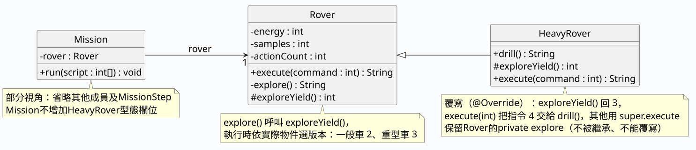

# 第八週設計文件：覆寫與多型基礎

> 老師發布的第八週學生教材沒有附 DESIGN 範本，本文件依投影片 F、G 段的要求整理：指定類別圖、覆寫的設計理由、課後遷移的車種與產量。
> 圖用 PlantUML 1.2026.10 產生：`java -jar C:\Users\qkall\ClassTools\plantuml.jar -charset UTF-8 -tsvg diagrams\dispatch_practice.puml`。

## 1. F1 類別圖：在圖上標出覆寫

- Rover 補上 `# exploreYield() : int`，並**保留** `- explore() : String`（private，不被繼承、不能覆寫）。
- HeavyRover 補上同一個方法 `# exploreYield() : int`，以及 D6 的 `+ execute(command : int) : String`，用註記標示這兩個是覆寫（`@Override`）。子類別和父類別出現同一個方法簽名，就代表覆寫。
- 繼承箭頭仍指向 Rover；Mission 的欄位型態仍是 Rover。Mission 的程式沒有用到 HeavyRover，所以不畫 Mission→HeavyRover。
- 部分視角：省略 getter、狀態查詢、scan、charge、drillCount 等成員與 MissionStep。

## 2. 為什麼這樣設計

| 決定 | 理由 |
|---|---|
| 產量拆成一個小方法 `exploreYield()` | 一般車和重型車探索時**唯一**不同的是產量。只開放這一小塊給子類別覆寫，扣能源、停止檢查、計次都留在父類別的 explore，不會被每種車重抄、抄錯 |
| `explore()` 維持 private | 不需要讓子類別複製整段探索流程；父流程呼叫可覆寫的產量方法就夠了 |
| 產量方法只回傳數字 | 父流程已經負責扣能源、加樣本、計次；子方法若再 `countAction()`，成功探索會被計兩次（D5 反例已實測抓到） |
| 覆寫 `execute` 只處理指令 4 | 其他指令用 `super.execute(command)` 交回父類別，規則只有一份；若把父類別的 switch 整份抄進子類別，之後改掃描或停止規則要改兩處，漏改一處兩種車就不一致 |
| Mission 一行都不改 | Mission 只認 Rover；靠「編譯看宣告型態、執行看實際物件」，同一份 `rover.execute(command)` 對重型車會執行 HeavyRover 的版本。之後再加一種車，只要寫新車自己，不必在 Mission 判斷車種 |

## 3. 課後遷移（F3）：SurveyRover 精細採樣車

- 路線 A。`SurveyRover extends Rover`，探索耗 6、**只得 1 份**；其他規則沿用 Rover。
- 只覆寫 `exploreYield()` 回 1（加 `@Override`），建構子自己寫 `super(energy, samples)`；不重寫 execute、不重複宣告狀態。
- 測試入口 `SurveyRoverTry` 用 Rover 參考接收、交給 Mission，不用 if 判斷車種。
- 產量較少不代表比較差：同樣跑 {1,1,2}，一般車三步達標，精細採樣車三步後只有 3 份，是規格效果。

| 案例 | 預期 |
|---|---|
| 20/0 跑 {1,1,2} | 6/3/3 任務未完成，3 步 |
| 6/4 跑 {1,3} | 0/5/1 任務成功，1 步 |
| 5/0 直接 execute(1) | 能源不足，5/0/0 |
| 20/5 直接 execute(1) | 任務已停止，20/5/0 |
| 一般車 20/0 跑 {1,1,2}（比較） | 6/5/3 任務成功，3 步 |
| 10/0 掃描、再充電 | 成功 8/1/1；成功 13/1/2（沿用原規則） |
| **本人反例** 6/4 跑 {1} | 0/5/1 任務成功，1 步 |

本人反例的用意：正確產量 1 讓樣本**剛好** 5 份、能源**剛好** 0。若產量方法沒被覆寫（仍得 2）會變成 6 份；若產量方法多計次，行動次數會變 2。兩種錯在只看「任務成功」時都抓不到，要比對精確的「能源/樣本/行動次數」。已在 repo 外副本實測：兩種錯誤版都被抓到（見 LAB_REPORT 遷移段）。
